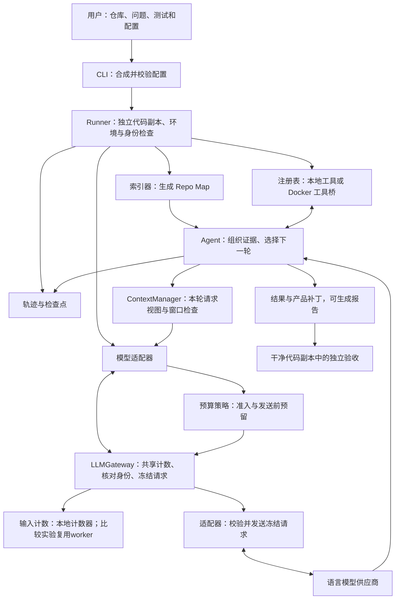
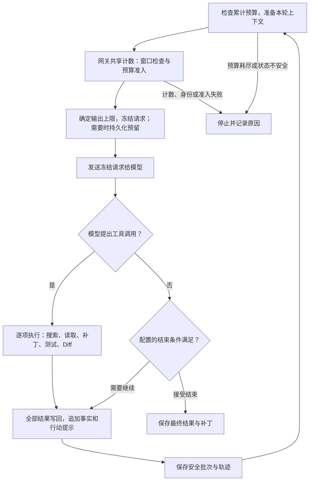
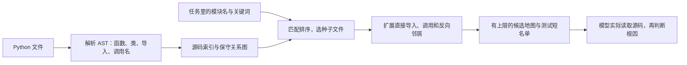
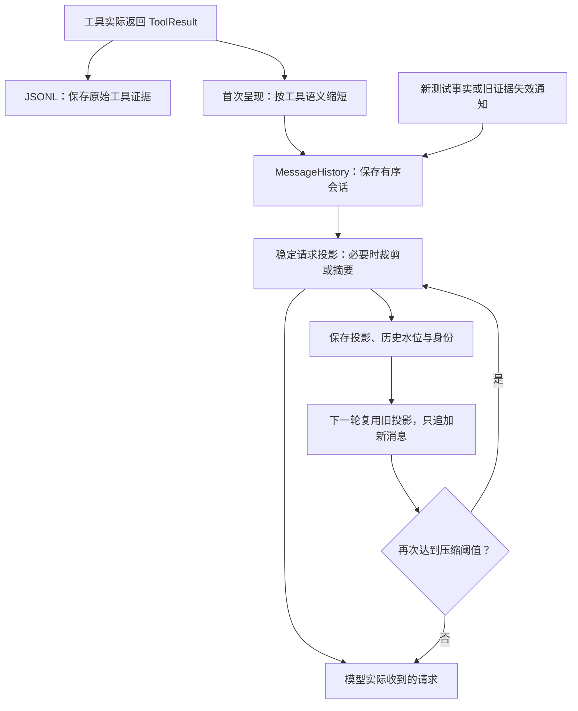
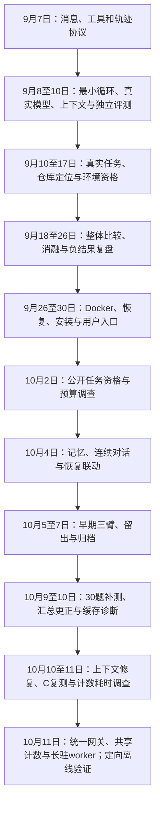
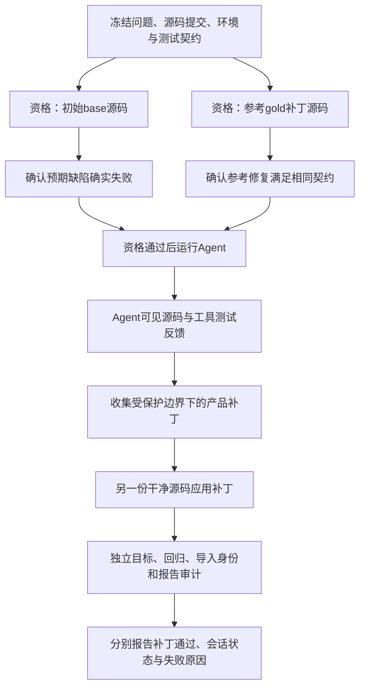

# TraceFix 全周期项目讲解稿：先看懂系统，再理解它怎样发展

> 阅读定位：面向懂基础Python、初学Agent的面试学习稿。覆盖2026年9月7日首次提交至10月11日最新复测、证据分析及统一LLM网关改动。先讲当前系统，再按当时的问题回看历史。源码链接指向当前实现，历史行为以所引版本和报告为准。个人灵感与贡献比例没有完整记录，本文不代为编造。

## 怎样阅读

第一次学习，先把第一部分当作一堂项目入门课：跟着分页问题，看模型、工具、地图、上下文和验收怎样合作。不需要先记住类名。第二部分再讲每项能力为什么出现、哪些方案尝试过、哪些实验没有支持采纳。面试前用第三部分组织口述，再沿追问回读对应原理。

项目的目标是：**围绕固定模型组织代码定位、受控修改、测试反馈、预算与独立验收，让一次修复能够交付，也能够解释和核对。** 最新30题中观察到完整交付增加，同时单题耗时更长；具体数字、费用口径与限制集中在第14章。随后完成的共享计数与长驻worker见第15章：已有定向离线证据，还没有改动后的真实模型速度结果。

目录：

- **当前系统**：[分页入门](#present-overview) · [组件装配](#present-assembly) · [消息与工具](#present-tools) · [Repo Map](#present-repomap)
- **基本设定**：[上下文三层与压缩](#present-context) · [预算与三种缓存](#present-budget) · [统一网关与长驻计数器](#present-gateway) · [配置对照](#present-config) · [验收、恢复与扩展](#present-verification)
- **早期搭建**：[1. 构思](#stage-1) · [2. 协议](#stage-2) · [3. 最小循环](#stage-3) · [4. 真实模型](#stage-4)
- **定位与实验**：[5. 首次失败](#stage-5) · [6. 可信评测](#stage-6) · [7. 仓库定位](#stage-7) · [8. 环境资格](#stage-8) · [9. 实验与负结果](#stage-9)
- **工程与交付**：[10. Docker恢复](#stage-10) · [11. 普通用户路径](#stage-11) · [12. 记忆与连续对话](#stage-12)
- **近期证据**：[13. 截至10月7日的对照与归档](#stage-13) · [14. 10月9日至11日的诊断、修复与复测](#stage-14) · [15. 10月11日的统一网关与长驻worker](#stage-15)
- **面试复习**：[实验表](#experiment-table) · [术语表](#glossary) · [两分钟／五分钟介绍](#introductions) · [技术追问](#questions)

每个历史阶段的“面试表达”都只是技术表达模板。将项目行为说成个人实现之前，请按实际参与情况调整主语。

## 第一部分：先看懂当前系统

<a id="present-overview"></a>
### 现在的 TraceFix 到底在做什么

先想象一个简单问题：一个商品接口每页返回十件商品，用户请求第一页，却拿到了第十一件到第二十件。你知道 Python，也会写测试，但刚接手仓库，不知道偏移量在哪计算。一个合理的修复过程是：找到分页入口，读实现和调用方，确认页码从 1 开始，把 `start = page * page_size` 改成 `(page - 1) * page_size`，运行相关测试，再检查其他分页边界和最终改动。

TraceFix 想让语言模型走完这样的过程。它接收问题和代码仓库，由模型决定下一步看什么、改什么；程序负责真实地搜索、读取、应用补丁、启动测试和保存证据。模型看到失败反馈后可以调整方案，直到给出结果，或者触及预算和其他停止条件。

这里的 **Agent**，可以先理解成“能根据上一步结果决定下一步的软件循环”。只请求模型一次、得到一段建议，仍要人替它找文件、落盘和测试。Agent 把这些动作接成循环。模型是作决策的部分，Agent 控制器是让决策按规则执行的部分；模型说“改好了”，不等于文件已经改变。

TraceFix 当前采用一个主要 Agent，不需要多个模型角色互相讨论才能修代码。它首先面向受信任的 Python／pytest 仓库。pytest 是 Python 的测试运行器：给它测试文件或具体用例，它会执行代码并报告通过、断言失败、导入失败等结果。一次修复最终交付的是可以检查的代码补丁，以及说明它怎样产生、怎样验证的记录。

读当前系统时，要带着两个问题：**模型怎样获得足够的事实？程序怎样确认动作和结果可信？** Repo Map（仓库地图）、上下文和缓存主要回答前一个问题；工具协议、预算、源码身份、独立验收和恢复主要回答后一个问题。两边互相影响：少读一段关键源码可能省输入，却让修复失败；测试通过后再改代码，则旧测试已不能证明新补丁正确。

本文描述的是截至 2026-10-11 的当前工作区实现。10月10日新增的上下文改动已进行定向检查和真实 C 组复测；10月11日随后新增的统一网关与长驻计数器完成了179项定向离线检查，没有新增供应商调用。当前仍有未提交修改，完整工程门槛与正式发布验收尚未完成。下文分开讲“已经写进代码的行为”“工程检查覆盖的行为”和“最新实验实际覆盖的行为”。

<a id="present-assembly"></a>
### 组件怎样组装起来：先准备现场，再让模型工作

**CLI** 就是命令行入口。用户在终端输入 `tracefix run`，它把仓库路径、任务、模型和预算整理成配置。命令行参数优先，其次环境变量，再次 TOML 配置文件，最后默认值。TOML 是便于人阅读的配置格式；配置结构经过 Pydantic 校验。Pydantic 可以理解为数据的入口检查器，例如拒绝未知字段、负预算和不合法类型，防止错误参数一路流到运行深处。

随后由 **Runner** 准备运行。Runner 是协调装配的程序，负责核对源 Git 仓库、创建独立代码副本、准备测试环境和产物目录。Git 保存代码版本；checkout 在这里指一份对应具体版本的工作目录。Agent 在新副本里修改和测试，修复不会直接覆盖用户原仓库。配置源码导入探针后，Runner还检查测试进程实际导入哪份源码，防止环境里安装的新版本冒充待修版本；正式任务资格和独立验收也审计这项身份。

Runner 接着建立模型适配器、工具注册表、仓库地图和轨迹记录器，把它们交给 Agent。**适配器**负责格式转换：外部供应商各有请求和响应细节，项目内部统一使用消息、工具调用和用量对象。LLM是“大语言模型”的英文缩写；适配器内部的**LLM网关**负责把同一请求的计数、身份检查和发送准备接起来，它是项目内的Python组件，不需要用户再部署服务。**注册表**则是一张“工具名称对应实现”的表，模型要求 `read_file` 时，控制器查表找到实际读取程序。



图中ContextManager先组织输入，适配器借网关计数；配置了费用限制的路径再做预算准入，最后发送已冻结的参数。上下文负责“给模型看什么”，预算策略负责“这次能不能发送”，网关负责让两者使用同一请求的计数成果。模型供应商变化主要由适配器处理；工具执行从本地切换到 Docker 时，执行位置变化，模型仍可使用熟悉的工具名称。Docker 是将源码、依赖和进程放进容器环境的技术，后文再讲它怎样帮助复现和隔离验收。

用几行伪代码抓住顺序即可，实际实现还会处理身份检查、失败和恢复：

```text
config = 读取并校验用户配置
workspace = 准备独立代码副本与测试环境
repo_map = 根据任务生成仓库地图
tools = 注册这个工作区允许的工具
llm = 创建模型适配器（内部持有本次运行的 LLMGateway）
agent = 组装模型、工具、配置、地图和轨迹记录器
try:
    result = agent.运行任务()
    保存结果、产品补丁与证据
finally:
    关闭本次创建的适配器、网关及所属计数worker
在另一个干净代码副本验收补丁
```

这是装配示意，不是可直接调用的Python API。Agent仍通过原来的 `complete(messages, tools)` 请求模型，网关接入发生在适配器内部。Runner关闭自己创建的实例；外部注入的实例由调用方管理。最后一步可以由用户另行运行 `verify`，也由正式实验流程执行，不能因为 Runner 运行结束，就默认独立验收通过。

源码：[运行装配](../../src/tracefix/runtime.py)、[模型适配器](../../src/tracefix/models/litellm_adapter.py)、[统一网关](../../src/tracefix/models/gateway.py)、[CLI与配置](../../src/tracefix/cli.py)、[Agent配置](../../src/tracefix/agent/base.py)。

<a id="present-tools"></a>
### 模型怎样动手：消息、五个工具和反馈循环

模型每轮收到一组消息和工具说明。消息有角色：`system` 放初始规则或程序事实，`user` 放任务和补充要求，`assistant` 放模型回答或动作请求，`tool` 放执行结果。角色帮助模型理解来源；当前实现不会因为一条新事实的角色是 `system`，就把它搬到历史开头。

**工具调用**是一份结构化动作申请，例如“读取 `catalog/pagination.py` 的第 20～60 行”。它有名称、参数和调用 ID。ID 像领取号码，把动作与结果一一对上：如果同一轮提出读取和搜索两个动作，模型下一轮必须知道哪条返回属于哪个动作。消息历史会拒绝未知 ID、重复结果和未闭合就插入下一轮的错误序列。

| 工具 | 人话解释 | 分页案例中的动作 |
| --- | --- | --- |
| `search_code` | 按文字搜索，缩小位置 | 查 `page_size` 和分页入口 |
| `read_file` | 读取真实文件及行范围 | 看偏移计算和调用约定 |
| `apply_patch` | 检查并应用一段代码修改 | 改起始下标 |
| `run_tests` | 启动受约束的 pytest 进程 | 运行已有分页用例 |
| `get_git_diff` | 看工作副本相对原版改了什么 | 检查是否只改预期实现 |

**补丁／Diff**是修改清单，不是整份仓库。它说明哪个文件的哪些旧行被哪些新行替换。补丁工具支持标准 Git diff 和模型常用的 Begin Patch 更新块，先检查路径和源码匹配，再落盘。失败会成为明确工具结果，模型能据此重读源码；重复提交相同失败补丁不会无限重做同一文件操作。



工具既提供能力，也控制动作范围。文件访问限定在工作区，拒绝越界、Git 元数据和真实 dotenv 密钥文件；pytest 使用参数数组启动，不交给任意 shell 执行命令字符串。不过 pytest 会执行目标仓库的 Python 代码，所以普通本地运行需要受信任仓库，不能据此宣称它是操作系统级安全沙箱。

网关没有替模型决定“还要不要读文件”。它只在每次请求之前做好计数和发送检查。模型响应有工具调用，就执行工具并进入下一轮；没有工具调用，再检查配置的结束条件。因此这是同一个Agent循环，多了一段可靠的请求准备链路。

Agent 会记录探索、修改、验证、收尾四个阶段。阶段帮助提醒和统计，不是替模型解决业务逻辑：先读高排名候选，探索过多时提醒收敛，测试和非空 Diff 就绪后提醒结束。源码再次变化会让旧测试失效，必须获得支持新版本的证据。

源码：[主循环与事实更新](../../src/tracefix/agent/minimal.py)、[消息协议](../../src/tracefix/messages.py)、[基础工具](../../src/tracefix/tools/builtin.py)。

<a id="present-repomap"></a>
### Repo Map：先给模型一张带路标的代码目录

**Repo Map** 就是仓库地图。一个仓库可能有几百个文件，模型不能凭文件名猜源码。地图先提供一份与任务相关的短目录：候选文件、函数和类的名称及行号、附近关联文件和测试。分页任务提到 `pagination`，地图可能把分页模块和调用它的接口放在前列，让第一次读取更有目标。

地图来自 **AST**，即解析后的语法树。Python 解析器把源码变成有结构的对象，程序能区分函数定义、类、导入和调用，无须执行业务代码。索引器扫描安全范围内的 Python 文件，记录符号、行号和关系，再建立“名字对应哪些文件”的索引。**符号**在这里主要指函数、类等代码定义的名称。

选文件分两步：先将任务中的词与路径、符号、导入和调用名称匹配，得到种子文件；再沿直接关系补几个邻居。例如分页入口导入了页码校验函数，校验文件虽未出现在任务里，也可能需要读取。**一跳**指只看直接相邻关系，不是一路追到所有依赖。当前排序是确定规则，路径匹配比符号匹配权重高，明确点名模块额外加分，不用模型或向量数据库生成排名。



地图有明确上限：默认最多索引 5,000 个文件，单文件最多 256,000 字节；先选最多 6 个源码种子，扩展最多 8 个邻居，最终最多给 12 个源码候选。每文件显示最多 8 个符号，另给最多 4 个测试候选，地图总长最多 12,000 字符。地图默认开启，并提示优先读前两个源码候选。

这些关系并不等于运行时真相。Python 可以动态导入、替换对象或通过别名调用；属性调用同名，也可能连到错误候选。解析失败、过大文件等会被跳过，因此地图会注明可能不完整。它的用途是缩小搜索范围，修改前仍须读取确认。首次读到目标更早，是定位指标；补丁通过独立验收，才是修复结果。两者不能互换。

源码：[仓库索引和地图](../../src/tracefix/repository/indexer.py)。

<a id="present-context"></a>
### 上下文怎样管理：留档、呈现和压缩是三件事

**上下文**是模型这一轮收到的材料：任务、规则、先前动作和结果等。模型接口不会自动替你记住所有历史，程序每轮要组织并发送需要的内容。随着轮次增加，一份长文件和长测试输出可能在后续请求中反复占位置，所以要控制材料大小。

当前实现要分三层理解。第一层是**工具原始证据**：工具实际返回的结构化结果，在 JSONL 轨迹中保存。JSONL 是每行一条 JSON 记录，便于逐事件追踪。第二层是**完整会话历史**：用户、模型、事实及工具消息按顺序保留。工具消息第一次加入时，可能已经经过呈现规则缩短，所以“完整历史”并不等于每个文件全文都未经裁剪。第三层是**请求视图**：本轮从历史生成、实际交给模型的材料，可以进一步裁剪和摘要。

**工具结果呈现**先按工具用途处理内容。默认搜索展示最多 6 个匹配，并说明还有省略；读取和测试输出的大文本字段各按 4,000 字符限制；Diff 按 5,000，通用字段按 2,000。它保留成功状态、错误、位置等必要字段。原始 ToolResult 另存轨迹，呈现结果固定进入消息历史，旧请求不被追溯修改。工具自身也有输出上限，轨迹保存的是实际返回证据，并非无限长度的所有文件和进程输出。

ContextManager 再做两类处理。新工具消息超过 8,192 字符时，保留开头 4,096、结尾 1,024 和省略标记；接近单轮窗口阈值时，把较早的完整工具批次转成确定性摘要。**确定性**指按照固定规则抽取已有内容，不再花一次模型调用写自由摘要。例如记录“读了哪个文件、补丁是否应用、测试怎样失败”，而不是让另一个模型重新推测任务。



压缩不能随便删。一次模型同时提出多个工具调用，相关结果全部返回才构成**闭合批次**；删掉请求、只留返回会破坏协议。当前规则保护初始任务与系统前缀，保留用户原文和顺序、已激活指导、最新测试事实与最新测试批次，再尽量保留近期内容。若保护内容本身太大，压缩目标可能达不到；最后连有效输入容量也放不下时就拒绝发送，不能偷偷删掉用户要求。

10月10日的重要变化是**稳定投影**：保存准备好的请求材料，记录已经处理到历史第几条，下一轮只拼接新消息。没有发生历史压缩也能复用投影，真正压缩时才建立下一代。检查点保存历史指纹、工具定义和tokenizer身份，恢复时核对。指纹就是根据内容计算的哈希值，帮助发现内容变化；tokenizer是文本计数器，下一节展开。旧内容或工具定义变化会阻止继续。

新测试事实同样改成尾部追加。假如原先第一页测试通过，后来又修改页码校验，系统追加“旧测试证据失效”，并要求新证据支持当前源码。新通知不会更新开头的旧事实消息；当前有效性由新事实说明，压缩时保护最新事实。此次30题付费复测没有实际触发历史压缩，因此验证的是事实追加和前缀稳定，不能把它当成80%／60%压缩及主动压缩的真实效果验证。

源码与说明：[工具呈现](../../src/tracefix/agent/presentation.py)、[上下文管理](../../src/tracefix/context/manager.py)、[当前上下文契约](../context-management.md)。

<a id="present-budget"></a>
### 窗口、累计预算和三种缓存，各管什么

**Token**是模型处理文本的计量单位，不等于一个汉字或一个单词。**Tokenizer**是把文本切成这些单位的工具。供应商返回的 **usage** 是这次调用的用量数据，可以包含输入、输出和缓存命中信息。字符数适合检查文本是否缩短，却不能直接当真实 Token 或账单。

**上下文窗口**控制一轮能放多少输入和输出，像一张桌子一次能摆多少材料。**累计预算**控制整个任务一共使用多少输入、输出、请求、测试和活动时间，像这项工作能花多少总资源。每次发10k输入，发三次累计约30k，即使每次都远小于窗口。供应商命中缓存也不代表这些输入从usage计数中消失。

当前默认窗口配置为1,000,000 Token，输出预留至少覆盖单次输出上限，并扣除窗口1%的安全余量：

```text
有效输入容量 = max(0, 窗口 - max(配置输出预留, 单次输出上限) - ceil(窗口 × 1%))
自动触发阈值 = 有效输入容量 × 80%
压缩目标 = 有效输入容量 × 60%
```

普通单次输出上限4,096时，有效输入容量为985,904；约788,723触发，目标约591,542。80%和60%都以有效容量为基数。目标不是承诺必然压到那个数，输出上限变化也会改变可用输入。显式绝对阈值仍可覆盖比例策略，老配置的retain比例在设置绝对阈值时保留兼容含义。

普通累计输入默认只有80k，而窗口默认接近百万，这并不矛盾：日常任务通常会先受到总使用量限制。行动提示在累计输入约50%、70%、85%时逐渐推动收敛；85%后仍保留一次定向取证机会。它们与窗口80%触发是两套规则。

“缓存”还要分三种。**读取缓存**由TraceFix管理：相同成功读取的结果已完整展示、仍在当前请求里，才返回一个小引用。先前只展示了半份结果，或者结果已被摘要掉，就重新读。成功补丁和测试都会清空旧读取缓存，因为现场可能变化。缓存不应让模型用从未看见的内容推理。

**计数缓存**现在由运行内的LLMGateway统一保存：窗口检查、实验输入准入和最终请求准备遇到同一份正文，可以取同一计数成果。它最多保留128项，只存内容哈希、计数身份、资格状态和数字，不复制整段历史，不写入检查点。正文或工具定义变化就重新计数；恢复进程建立新缓存。当前官方计数绑定固定`deepseek-recipe==0.1.1`与tokenizer文件指纹，不能用换了一把尺的结果接着算。官方模板计数仍标为`estimate`；网关不会因为它来自官方文件，就把估计升级成硬上界资格。上下文计数不可用时会记录本地JSON估算方式，已固定的身份损坏或变化则拒绝继续。

**供应商前缀缓存**在模型服务端：开头相同的一大段材料有机会复用已处理内容。原C把动态测试事实插在第二条消息，更新事实就改变了很前面的位置，后面的静态材料虽相同，也难以匹配旧前缀。新C把事实追加在尾部，旧开头保持稳定。缓存命中必须看供应商usage，不能只凭本地字符串相同判断。

三种缓存分别节省文件读取、本地文本计数、供应商处理前缀的工作。最新30题复测使用的还是改网关之前的链路，它重复启动WSL worker，窗口检查与费用准入也没有共享计数。WSL是Windows运行Linux程序的环境；重复启动、加载和校验带来额外时间。10月11日随后实现共享计数和长驻进程，定向离线检查已通过，真实耗时收益仍待测。它不会直接改变模型看到的任务，也不会让供应商自动少收Token费用。

付费实验另有**发送前预留**：先按协议占用下一请求可能花费的额度，收到可信usage后结算。响应未知时保留责任并停止，不能按零费用重发。预留责任、按usage估算的费用和供应商实际账单是不同数字。

依据：[预算与配置](../../src/tracefix/agent/base.py)、[官方计数边界](../../src/tracefix/models/input_bounds.py)、[统一网关](../../src/tracefix/models/gateway.py)、[缓存诊断](../experiments/2026-10-10-b-c-cache-diagnosis.md)、[复测耗时复核](../experiments/2026-10-11-b-c-context-comparison.md)。

<a id="present-gateway"></a>
### 统一网关：同一份材料只量一次，发出去的必须是检查过的那份

假设分页任务的一轮输入，按固定tokenizer计为10,000 Token。ContextManager先问“这轮材料放得下吗”，实验预算适配器随后问“累计输入还能容纳吗”。以前两处可能分别编码同一文本；现在适配器向网关取一份计数成果，后一次直接复用。**共享的是同一正文的计数，不是所有轮次都沿用10,000**：读完源码后新增工具消息，正文变了，下一轮必须重算；上下文裁剪后也要重算。

同一成果里保留两个数字。一个是 **InputBound**，可以理解为“输入数量及这把尺的可信程度”；精确、可验证上界、估计、不可用分别记为`verified_exact`、`verified_upper_bound`、`estimate`、`unavailable`。另一个是既有的保守输入上界，服务原费用预留。比较实验仍按UTF-8字节数加固定余量估计输入责任，没有改成较小的官方估计来放宽预算。例如官方计数10,000、保守数字18,000，窗口和实验输入准入使用前者，比较实验的费用预留仍使用后者，再加输出责任。数字只是示例，不是真实分页运行记录。

各路径的规则仍各自负责。普通未配置费用预算的适配器在本地计数不可用时可以保留`unavailable`并发送；需要可审计上界的预算路径会拒绝缺失上界。**正式P2**是项目用于冻结协议、严格准入与评分的实验流程，它继续只接受已确认的精确计数或可验证上界，拒绝未经资格确认的`estimate`。统一准备机制不意味着所有运行都使用同一种预算策略。

还要分清两个“身份”。**计数正文身份**回答“是不是同一份要量的材料”，绑定模型、端点、消息、工具、thinking设置和计数器编码身份。**最终请求身份**回答“究竟发了什么”，覆盖实际发送参数。哈希是内容指纹：内容变了，就会得到不同指纹。若预算将输出上限从4,096收紧到2,048，输入正文没变，可以复用输入计数，但最终请求必须重新冻结并计算指纹。模型或端点在运行内漂移则拒绝；温度、超时、重试等已计数请求设置也受保护，不能借输出上限调整一起偷偷改变。

**冻结请求**就是把最终参数序列化成不可变的一份材料。适配器发送前同时核对完整请求指纹和计数正文指纹，再直接使用这份参数。预算通过后不再从可变配置重新拼装请求，避免“检查的是甲、发出的是乙”。这也修正了P2收紧输出上限后，计数记录仍绑定旧请求指纹的问题。

**长驻worker**是持续等待本地计数任务的子进程。正式比较实验的OfficialCounter第一次需要计数时启动它，校验固定依赖与tokenizer、加载编码器，再通过JSON Lines逐行交换请求和结果。后续正文仍须编码，但复用已加载的编码器。普通适配器与P2也使用网关准备请求，本地计数可以在Python进程内完成，不意味着每次普通运行都要启动WSL。旧的一次性计数入口继续保留。

worker启动时完整检查文件哈希；每次计数前核对冻结清单的文件大小和修改时间。客户端检查协议版本、请求ID、固定身份和结果数量，使用读取线程与队列实现跨平台超时，并持续排空错误输出、只保留有界诊断，避免日志塞满管道后卡住。单次期限120秒、批量1800秒，覆盖启动、写入和等待响应。超时、退出、坏JSON、错ID或身份变化会关闭并锁定这个实例，不能自动重启重发。任务结束关闭输入，等进程退出，必要时终止所属子进程；重复关闭安全，不关闭整个WSL。

恢复也不是把旧worker接回来：新进程重新握手，核对保存身份，重新建立计数缓存。计数、身份或预算失败发生在供应商发送前，记录未发送；发送前仍持久化费用预留与待响应记录。真正发送后的硬超时或usage缺失继续按未知请求处理，保留责任并阻止下一次调用。长驻计数器的本地超时与供应商请求的硬超时互相独立。

实现与检查：[网关](../../src/tracefix/models/gateway.py)、[适配器](../../src/tracefix/models/litellm_adapter.py)、[比较预算](../../src/tracefix/comparison.py)、[worker客户端](../../src/tracefix/comparison_profiles.py)、[worker协议](../../src/tracefix/comparison_counter.py)、[P2准入](../../src/tracefix/p2_protocol.py)、[定向测试](../../tests/test_llm_gateway.py)。本地真实子进程验证了协议与复用；本机缺少官方tokenizer环境，尚未完成实际编码器子进程的一致性与冷启动／复用耗时检查。

<a id="present-config"></a>
### 最基本的配置：普通默认与实验覆盖分开读

下面的普通默认来自当前工作区代码，复测列说明本轮冻结实验，历史列只取10月5日那次90运行的C配置，不把所有旧版本混成一个默认。模型别名、返回身份、请求参数和源码快照应以各自报告为准；最新横向报告中的供应商返回模型为`deepseek-flash`。30题复测早于网关改动；不能把现在的共享计数或长驻worker当作当时的实验配置。

`temperature`控制回答的随机程度，0偏向稳定选择，但不保证多次回答完全一致。关闭思考是该批模型参数；非流式表示一次接收完整响应，零重试表示失败后不自动再请求。普通120秒是客户端超时配置，实验180秒还由独立父进程按实际经过时间强制回收，约束更明确。

| 配置 | 普通运行默认 | 最新C同题30题复测 | 早期历史：10月5日C对照 |
| --- | --- | --- | --- |
| 模型别名 | `deepseek/deepseek-flash` | 同别名 | 同模型系列，以冻结身份为准 |
| temperature | 0 | 0，关闭思考、非流式 | 0，关闭思考、非流式 |
| 请求超时／重试 | 120秒／2次 | 180秒独立进程硬期限／0次 | 60秒配置／0次 |
| 活动时间 | 1,200秒 | 每题3,600秒 | 900秒 |
| 步骤／测试预算 | 30／8 | 极大兼容上限，实际受时间与费用约束 | 最多20请求／16测试 |
| 累计输入／输出 | 80k／20k | 无额外累计Token限制，使用极大兼容上限 | 60k／8k |
| 单次输出上限 | 4,096 | 配置393,216，发送前可协商缩小 | C为2,048，并传递剩余额度 |
| 自动压缩策略 | 有效输入容量80%触发／60%目标 | 相同比例，实测历史压缩0次 | 当时产品策略，不能倒写为新版80%／60% |
| Repo Map与基础优化 | 默认开 | C按冻结配置开启 | C启用当时产品策略 |
| Agent主动压缩工具 | 默认关 | 关 | 尚无此次新增入口 |
| 请求视图记录 | 默认关 | 开 | 以原批次保存材料为准 |
| 请求准备与计数 | 当前适配器内部网关，运行内最多128项 | 当时未接共享网关，计数重复、worker反复启动 | 按历史版本与协议，不倒写新机制 |
| 额外能力 | Skills、记忆、连续对话、Docker恢复默认关 | 记忆、Skills、MCP、连续对话关闭；Docker恢复未参与 | 记忆、Skills、MCP、连续对话关闭 |
| 人民币授权 | 不自动继承实验额度 | 每题¥10，总授权独立¥300 | 整批独立授权¥20 |

普通窗口配置为1,000,000 Token，最新实验冻结为1,048,576。更早的32k／3k是对应实验的**压缩软触发阈值**，不是模型硬窗口，也不是整题累计预算；具体配置分别见[32k长任务](../experiments/v0.3.1-context-32k-ab.md)和[10月5日冻结协议](../experiments/2026-10-05-agent-model-comparison.md)。相同工具名称不意味着跨版本策略完全相同。

最小配置可先写在目标仓库外的`config.toml`，路径相对这个文件解析：

```toml
[run]
repo = "../my-python-project"
task = "修复已有分页测试暴露的第一页偏移错误"
test_python = "../my-python-project/.venv/Scripts/python.exe"
test_target = "tests/test_pagination.py"
source_import = "my_package"
output_dir = "./runs"
model = "deepseek/deepseek-flash"
env_file = "./.env"
```

`source_import`填写项目实际模块名；`test_target`必须是已有测试路径或具体用例ID；测试Python需要预装仓库依赖。输出目录位于源仓库外，API Key只在进程环境或`.env`里。普通用户先运行`tracefix doctor --config config.toml --prepare`检查环境，再运行`run`，之后`verify`、`report`、`export`检查和导出结果。`doctor`不发送模型请求。

一般不用一开始调遍全部参数。先确定源码、测试、输出位置和合理预算；要改变窗口策略，再显式设置`context_window_tokens`、`context_trigger_ratio`、`context_target_ratio`及`context_output_reserve_tokens`。普通配置不是正式实验协议：实验还要固定任务身份、源码快照、模型参数、费用授权、执行顺序和评分定义。

依据：[普通用户说明](../ordinary-repository.md)、[配置入口](../../src/tracefix/cli.py)、[实验资源配置](../../src/tracefix/comparison_profiles.py)。

<a id="present-verification"></a>
### 怎样判断修好、怎样恢复，以及可选增强放在哪里

“模型结束了”“模型自选测试通过”“声明目标通过”“独立补丁通过”是不同结论。模型可以自信结束，但测试未必执行；某个测试通过，也可能漏掉第一页为空或页码为负的边界。系统必须保存具体执行证据，不能拿一段最终回答替代它。

普通`require_tested_completion`默认关闭。用户显式配置额外`regression_targets`时，结束前回归门先记录已有目标基线，再在模型准备结束时执行原目标与追加目标，失败返回模型继续修；预算不足或证据不完整则不能声称通过。**回归**是确认修这处错误没有破坏既有行为，验收范围仍限于明列测试。

**独立验收**将Agent的产品补丁放入另一份干净源码，重新运行指定集合，检查实际导入来源、执行节点和依赖身份。它避免依赖Agent现场残留的测试修改、缓存或临时文件。正式任务还先证明原版在契约上失败、参考修复通过，确认题目可测，再评价模型；详细资格历程见后文。

**检查点**是可继续工作的状态存档，保存消息、预算、阶段和身份。只在模型响应已知、工具批次完整时保存。读取完成后暂停，可以继续下一轮；补丁结果未知时重放可能重复修改，模型请求未知时重发可能重复收费，所以拒绝自动越过未知状态。恢复核对源码、配置、工具、历史投影与环境，连续对话不会重置累计预算。

网关的128项计数缓存不属于可恢复状态。恢复创建新适配器和网关，需要worker的实验路径重新启动并握手；保存的计数器身份要一致。任务异常退出也走清理流程，关闭自己创建的资源。这样复用进程只改变本次运行的工程开销，不越过未知请求或身份检查。

Docker让依赖和执行环境更可固定，已验证的普通Docker恢复会重建容器，并用另一个干净容器验收。**Skills**是按需加载的操作指导；**MCP**是连接外部工具服务的协议，当前可选Serena只注册只读符号查询；**经验记忆**把有测试和工具支持的操作经验保存到仓库外，下次按任务召回。它们分别补指导、查询和可复用经验，默认开关与适用后端有限制，接入成功不等于提高修复率。

这就构成了TraceFix的基本链路：准备现场，帮助定位，受控行动，返回真实反馈，管理材料与预算，保存证据，再独立验收。理解这条链后，下面的开发历程会更容易读：每一轮增加的能力，都在解决链路里实际暴露的问题。

依据：[恢复说明](../recovery.md)、[普通Docker](../ordinary-docker.md)、[记忆实现](../../src/tracefix/memory.py)、[最新复测及工程边界](../experiments/2026-10-11-c-context-retest-30.md)。

<a id="history-overview"></a>
## 第二部分：这些能力是怎样一步步长出来的

下面回到开发当时。前面解释的是当前组合，后面解释的是选择的由来；不要把今天的完整架构倒写成第一天就全部存在。版本、提交和实验链接用于查证，不需要逐项背诵。



这条线表示关注点的变化，各方向有重叠。归档是保存和精简证据，不表示此后停止开发；也不是每项增强都已经证明模型效果。

<a id="stage-1"></a>
### 1. 最初构思：为什么要做 TraceFix

#### 1.1 项目要回答的实际问题

从报错得到合理建议只是起点。真实仓库还要求定位正确文件、适配当前源码、落盘修改、检查回归，并留下可用补丁。项目构思围绕这些交付条件展开。

从路线图与早期代码能够还原的技术方向是：**固定模型能力，把改进空间放在模型获取信息、执行动作和接受反馈的过程上。** 如果一个任务读了大量无关文件，即使模型判断很强，也会消耗更多输入、时间和费用；如果工具无法接受模型生成的补丁，正确思路也无法变成正确源码。因此，项目同时关心成功率和成本效率。

#### 1.2 初始范围为什么这样收敛

最早采用单Agent和同步工具接口，便于对应请求、批次与状态，把失败定位到具体边界。先证明一条链路可靠，再考虑额外协作，是从实现顺序可解释的取舍；个人构思经历没有记录，不能代为编造。

Python 与 pytest 提供了适合第一阶段的验证条件：源码便于分析，测试可以由命令启动，失败输出可以返回给模型，后续还能用 Python 的语法树提取结构。最初用小型合成任务控制变量，再逐步转向真实 GitHub Issue。GitHub Issue 在这里指上游项目已有的问题记录，不代表 TraceFix 向上游提交或合并了对应修复。

预算从早期进入设计：步骤、输入、输出、时间和测试次数分别受控。项目希望减少无效探索和重复发送，而不只是要求模型少回答几句。

#### 1.3 后来的重点怎样扩展

最初追求修复效率，真实运行又暴露验证与工程问题，逐步推动定位、上下文、独立验收、隔离、恢复与用户入口出现。它们都要求决策依据、执行和结果对得上。

**面试表达：**“TraceFix 的切入点是固定模型下的修复流程优化：让模型拿到相关证据，通过真实工具反馈修正方案，并把预算与最终补丁验证纳入同一个工程闭环。”

依据：[路线图](../roadmap.md)、[开发历程](../development-history.md)。Git 历史中首次提交为 2026-09-07 的 `547dd7f`，核心骨架提交为 `6243e2a`。

<a id="stage-2"></a>
### 2. 第一版骨架：先确定模块之间怎样交流

#### 2.1 为什么最初先写接口

V0 阶段没有立刻把模型请求、文件操作和评测写进一个大循环，而是先固定模块边界。原因是 Agent 系统会交换多种对象：用户任务、模型文本、工具请求、工具返回、用量、状态和错误。若所有模块随意读写字典，字段缺失与角色混淆往往要到远处才表现为失败，排查会变得困难。

项目采用 `src/tracefix/` 包布局，把消息、模型、工具、Agent 和轨迹分别组织，并用 Pydantic 定义数据结构。Pydantic 的作用是按照声明校验运行时输入，例如工具调用必须有名称和 ID、Token 计数应满足类型要求。抽象接口则规定替换模块时必须具备的行为，便于使用固定响应替身测试控制流。

主要协议包括：`Message` 表示一条消息；`ToolCall` 表示模型提出的动作；`LLMResponse` 统一模型返回；`TokenUsage` 保存用量；`ToolSpec` 描述工具名称和参数；`ToolResult` 保存执行结果；`TraceEvent` 表示可持久化事件。`BaseLLM.complete()` 与 `BaseTool.execute()` 分别定义模型和工具的同步调用边界。

#### 2.2 一次读取为什么需要调用 ID

假设模型要求读取 `catalog/pagination.py`。下面是用于理解当前协议的最小 Python 示例，只构造消息，不读写文件、不调用模型：

```python
from tracefix.messages import Message, MessageHistory, MessageRole, ToolCall

call = ToolCall(id="read-1", name="read_file",
                arguments={"path": "catalog/pagination.py"})
history = MessageHistory([
    Message(role=MessageRole.USER, content="修复第一页分页偏移"),
    Message(role=MessageRole.ASSISTANT, tool_calls=(call,)),
    Message(role=MessageRole.TOOL, tool_call_id="read-1",
            content="示例返回：start = page * page_size"),
])
assert not history.pending_tool_call_ids
```

`read-1` 把请求与返回关联起来。如果模型同时发出多个调用，程序仍能确定每条结果属于哪个请求。`MessageHistory` 会拒绝未知 ID、同一请求重复返回，以及工具尚未全部回应就插入下一条非工具消息。一次追加失败也不会留下半截历史。这样保证了“模型看到了什么反馈”有明确的协议基础。

工具注册表按稳定名称寻找实现，重复注册会被拒绝，避免同名工具在不同位置执行不同动作。异常也按模型、工具、预算、消息、轨迹等层次区分，保留原始异常链；上层可以决定停止还是把可恢复错误交给模型，而不必把所有异常压成一个模糊字符串。

#### 2.3 这一步怎样帮助后续扩展

稳定协议后来支撑真实模型、Docker工具桥和恢复接入，变化集中在各自模块。类型校验先排除协议错误，业务正确仍靠测试。

**面试表达：**“第一阶段先建立消息、工具和轨迹协议，尤其校验工具调用与结果配对。这让后续模型接入、容器执行和恢复都能复用同一套可测试边界。”

源码：[消息协议](../../src/tracefix/messages.py)、[模型接口](../../src/tracefix/models/base.py)、[工具协议与注册表](../../src/tracefix/tools/base.py)。历史依据：[V0 开发记录](../development-history.md)。

<a id="stage-3"></a>
### 3. 最小 Agent 闭环：模型怎样开始实际修代码

#### 3.1 从一次回答变成反馈循环

2026-09-08 的 V0.1 加入 `MinimalAgent`。工作方式是发送任务与历史，让模型选择动作，执行工具，再把结果加入历史。如果补丁失败，模型看到失败原因；如果测试失败，模型得到错误输出；如果证据足够，模型可以提出最终答复。一次失败因此可以成为下一轮决策的输入。

第一部分已经给出当前循环。历史上先实现工具反馈与终止管理，结束前验收和恢复是在后续加入的。最初版本的意义，是把“模型建议”变成“程序执行后再反馈”的可测试过程。

#### 3.2 为什么这五个工具足够起步

五个工具分别覆盖定位、理解、修改、验证和交付。模型声称“已修改”或“测试通过”都不能充当证据，必须看到真实工具执行结果。这条原则后来继续约束报告与独立验收。

工具最初就带有执行约束：路径限制在工作区内，拒绝越界、敏感 dotenv 和 Git 元数据访问；补丁先检查可应用性再落盘；pytest 通过参数数组启动，使用 `shell=False`。这种限制减少了错误动作范围，但本地 pytest 仍会执行仓库代码，因此本地模式的定位是受信任仓库，不能称为完整操作系统沙箱。

#### 3.3 为什么要有多种预算

只限制轮数无法限制一轮读入的内容，只限制 Token 也不能阻止测试长时间挂起。因此 Agent 分别管理模型步骤、输入、输出、活动时间和测试启动次数。终止时也要处理尚未得到执行结果的工具调用，补上明确的失败结果以保持消息配对；这与未知供应商请求的费用状态是不同层面的问题。

最小闭环可以用固定模型响应测试，无须先消耗真实调用。这样的测试验证控制器是否按顺序执行、正确记账和正确停止；模型是否能自主找出修复方案，要在真实模型实验里另测。

**面试表达：**“模型负责选择下一步，程序负责受控执行和真实反馈。最小闭环先把五个基础动作与预算终止做好，再通过可替换模型接口验证控制流。”

源码：[Agent 主循环](../../src/tracefix/agent/minimal.py)、[Agent 状态与配置](../../src/tracefix/agent/base.py)、[基础工具](../../src/tracefix/tools/builtin.py)。历史提交：`5c6e15b`；早期标签名 `v1` 对应包版本 `0.1.0`。

<a id="stage-4"></a>
### 4. 接入真实模型：从测试框架变成可运行系统

#### 4.1 真实调用增加了什么工程问题

V0.2于9月9日接入真实模型与CLI。LiteLLM适配层把供应商格式转换为已有协议，处理工具、响应与计量缺失，让Agent沿用统一接口。

这一版 Runner 把源码准备与模型执行组织起来：核对 Git 提交，创建不使用硬链接的独立克隆，组装工具与模型，运行后保存产物。修复落在独立工作区，成为可检查、可导出的补丁。

配置采用命令行、环境变量、默认值的明确优先级。密钥由运行进程读取，不作为任务消息交给模型，不复制进工作区；测试子进程清理敏感环境变量。这里解决的是具体泄漏路径，后续分享轨迹仍要考虑其中的业务源码内容。

#### 4.2 一次运行留下哪些证据

这一版确立了 `trajectory.jsonl`、`result.json`、`patch.diff` 与工作区四类基本产物。后面的报告与恢复都需要这些可追溯材料，而不只是终端里的一句“成功”。

结构化产物使停止原因、修改依据和最终补丁可以分别复核，后来HTML报告与恢复机制沿用这条证据链。

用量通常来自供应商返回的 usage，也就是一次响应附带的输入、输出等计量信息。早期费用包含 LiteLLM 美元估算与固定汇率人民币换算；后续实验又使用人民币保守账本。两者都是各自协议中的计算口径，不能直接当作供应商实际扣费发票。

#### 4.3 为什么先做十道合成任务

第一批十道短 Python Bug 有明确初始源码、测试与标准修复。标准修复称为 gold patch，用来证明题目在指定条件下可解，不提供给被测 Agent。自动验证先确认初始任务失败，再确认 gold 修复后通过，减少“任务本身定义错了”的可能。

真实模型 Baseline，也就是后续比较的起始基线，在这十道任务上得到 **10/10**，累计输入 184,730 Token、74 个步骤。它说明工具、模型、Runner 和外部测试能够连成闭环，简单错误可以被修复。任务小、结构受控，不能据此推断真实大型仓库的表现。

当时工程验收为100项测试、92.39%覆盖率，与十题模型通过分别记账。下一步转向长轨迹：怎样减少重复历史，却保留修复依据？

**面试表达：**“真实模型接入后，Runner 把源码隔离、配置、用量和运行产物统一起来。十道合成任务先建立可复现基线，随后才逐步提高任务真实性和评测强度。”

源码：[LiteLLM 适配层](../../src/tracefix/models/litellm_adapter.py)、[Runner](../../src/tracefix/runtime.py)、[合成评测器](../../src/tracefix/benchmark.py)。数据：[早期实验索引](../experiments/README.md)。历史提交：`657fdc1`。

<a id="stage-5"></a>
### 5. 上下文优化与第一次关键失败

#### 5.1 长轨迹为什么越来越贵

多轮重复发送的成本促使 V0.3 引入确定性分层上下文管理：先缩短长工具返回，再摘要完整旧批次，不额外调用摘要模型。最初方案每轮从历史生成临时视图；10月10日才进一步引入保存后复用的稳定投影。

当时采用32k软触发阈值和约37.5%的近期保留比例。它们是早期实验配置，不是今天的默认80%／60%策略；单轮窗口与累计预算也分别计算。原始工具证据保存在轨迹中，消息历史和实际请求视图的区别见[当前上下文讲解](#present-context)。

#### 5.2 3k 压力实验为何没有直接证明压缩有害

为了制造上下文压力，早期把阈值压到 3k，在相同十道短任务上运行。结果从 10/10 变成 **7/10**，输入和费用反而上升，完全重复调用增至 23 次。但查看轨迹发现，三个失败任务在第一次历史折叠之前就已经发生补丁失败。

问题是模型生成了工具尚不支持的 Begin Patch 格式，或者 unified diff 中的 hunk 行数不正确。hunk 是补丁中的一段修改说明。模型的修复方向可能正确，但工具无法应用；后续不断重试又缺少恢复约束。仅凭最终成功率下降归因于压缩，会把更早发生的工具缺陷混进去。

V0.3.1 支持两种补丁格式：对 Begin Patch 严格匹配源码上下文后转换为标准 diff，对 Git diff 使用 `--recount` 修正行数；危险路径、歧义和实际上下文不匹配仍拒绝。相同失败补丁不重复执行，多次失败后提示重新读取源码，测试通过且 Diff 非空后提示收尾。

回归恢复到 **10/10**，输入降至 110,060，步骤降至 53，没有工具失败与重复调用。相对最初基线输入下降 40.42%，但这一轮压缩次数为零。因此主要收益是协议兼容和更快收敛，不能记在历史压缩名下。

#### 5.3 怎样专门验证压缩机制

随后构造两道受控长任务，每题分布 24 份较大契约，并限制每轮读取数量，使轨迹自然越过 32k。契约可以理解为描述业务规则的文本，模型必须读取后综合判断。两组使用同代码、同模型、同任务和预算，只切换上下文管理。

两组均解决 **2/2**，输入从 370,387 降到 185,587，下降 **49.89%**；估算费用下降 **9.67%**。其中一题两组都读完相同 24 份契约，处理组甚至多一步，经过五次折叠后输入仍下降 59.69%，为机制提供了较强证据。另一题还混有工具裁剪和步骤差异，不能全部归因于历史折叠。

两题、每组一次仍不足以估计真实 Issue 平均收益。这个阶段最值得记住的方法是：先检查机制是否触发，再排除更早的失败原因，最后讨论效果大小。

**面试表达：**“早期压力实验把成功率降到了7/10，轨迹却显示问题先发生在补丁协议。修复工具后回归到10/10，再用真正超过阈值的长任务单独检验压缩。”

源码：[上下文管理](../../src/tracefix/context/manager.py)、[补丁工具](../../src/tracefix/tools/builtin.py)。证据：[3k 压力实验](../experiments/v0.3.0-context-3k.md)、[Agent 回归](../experiments/v0.3.1-agent-loop-regression.md)、[32k 长任务对照](../experiments/v0.3.1-context-32k-ab.md)。

<a id="stage-6"></a>
### 6. 评测升级：怎样判断修复是真的正确

#### 6.1 为什么模型说完成还不够

Agent 可以选一个很容易通过的测试，也可能不小心修改测试、错误导入环境里已安装的另一份代码，或者在预算耗尽前已经留下正确补丁。这些情况说明“会话结束”“测试通过”和“补丁正确”需要分别观察。

V0.3.2 与 V0.4.0 增加多文件语义任务、隐藏验收和重复配对实验。隐藏测试指运行时不给 Agent 看、结束后用于评判的测试；其作用是检查模型是否只迎合公开样例。早期合成入口结束后把隐藏测试加入工作区，后续真实任务逐步强化为另一份干净源码的补丁验收。不要把今天的隔离强度倒写成第一版就具备。

这一阶段开始分别报告正常结束、自选测试通过、公开回归与独立验收；它们的区别见[当前验收讲解](#present-verification)。早期 `resolved` 取当时协议规定的联合条件。10月5日对照以独立补丁通过为主要指标，10月11日则以“正常完成且独立通过”为主成功，不能把不同时期的同名数字混算。

#### 6.2 评测与反馈怎样分开

Agent 内测试帮助模型修正方案，消耗它的测试预算。外部独立验收判断最终产品补丁，不把隐藏结果送回被测 Agent，也不占 Agent 内测试次数。训练式反馈与最终考试分开，才能避免模型根据隐藏答案不断修改，最后还称为独立评测。



图将资格、修复与独立验收分开。参考补丁和隐藏验收材料只由资格／验收端使用；三类结果之间有依赖，却不是同一项成绩。

#### 6.3 怎么知道当时运行的是哪一版

项目加入RunProvenance运行来源清单，记录提交、未提交修改、任务指纹、模型参数、Python与依赖版本。请求视图记录还保存实际发出的消息和工具定义，便于核对模型当时看到了什么。

重复配对采用每题至少三次、C/T 与 T/C 交替，减少运行顺序和单次采样造成的误判。控制组 C 是某轮的基线，处理组 T 是那轮待检验策略；这些字母不是跨所有实验固定不变的产品配置。

V0.4.0 的四题×三次×两组，共24次，两组均 **12/12**，但处理组没有发生历史折叠，输入还增加3.99%。正确解释是任务未触发待测机制，不能据此说压缩提升准确率，也不能把波动解释为折叠副作用。这推动了后续真实任务筛选与机制触发检查。

**面试表达：**“评测逐步把模型完成、自选测试、独立验收和测试修改拆开，再固定运行身份与配对顺序。实验首先确认它测到了目标机制。”

源码：[运行来源](../../src/tracefix/provenance.py)、[配对评测](../../src/tracefix/paired.py)。证据：[独立验收设计](../tasks/v0.4.0-independent-verification-and-paired-eval.md)、[24次配对结果](../experiments/v0.4.0-paired-context-32k.md)。

<a id="stage-7"></a>
### 7. 走向真实仓库：从找不到文件到仓库索引

#### 7.1 真实任务先暴露了定位问题

V0.5.0 接入 SWE-bench Verified 来源的 pytest、Pylint、Sphinx 三个真实 Issue，固定 base commit、问题、参考修复和测试补丁。SWE-bench 是将真实仓库问题整理为修复任务的数据集；使用其任务材料不等于完成了它的全部官方评测。

三题先证明选定隐藏用例在 base 上失败、gold 后通过，再做单次32k预筛选。最大单次请求估算约13.9k～28.3k，零题触发历史折叠，因此没有继续原本可能安排的18次压缩配对。轨迹显示 Pylint、Sphinx 主要卡在定位，pytest 虽形成修改却涉及测试且未通过隐藏验收。下一步于是选了仓库索引，而非继续降低压缩阈值。

#### 7.2 AST 和 Repo Map 怎样帮助模型

为了帮助定位，项目开始用 Python AST 提取文件与符号，再通过导入与引用关系补充候选。早期词法候选不能充分连接公开入口和实际实现，后续逐步加入反向索引、相对导入、一跳扩展、源码目录偏好和关系权重；当前具体算法见[Repo Map讲解](#present-repomap)。

地图大小也必须受控，新增材料会增加每轮输入。参考补丁只在评测端提供目标文件标签，不能把答案文件列表喂给定位器。

首轮三题离线定位总体没有改善。扩展结构关系后 Hit@5 达100%，但首位仍不理想；种子排序后同样本 Hit@1 为66.67%、MRR为0.833。Hit@5 表示正确文件是否进入前五，MRR反映正确候选排得多靠前。它们检验的是定位，不检验模型读完后是否会正确修改。

#### 7.3 为什么定位提前仍然修不好

后续关闭／开启 Repo Map 的六次真实预筛选，首次读取目标文件平均从第2.00步提前到1.33步，但六次全部因预算限制中断，按当时严格`resolved`条件均为0。其中关闭组的pytest补丁隐藏验收通过，却未正常结束、未运行公开测试，不能称为完整解决。地图可能更快指路，Agent仍会持续探索，难以稳定完成补丁、测试和收尾。

V0.6.1 因此引入 EXPLORE、PATCH、VERIFY、FINISH 四个行动阶段，以及预算比例提示、紧凑只读缓存和更小的默认搜索结果。阶段用于组织行动与统计，不意味着程序替模型判断了所有业务逻辑。后续 V0.7 系列还细分无效补丁反馈与真实任务预算，普通运行默认预算和真实实验配置分别管理。

缓存也有代价：文件修改后旧结果可能失效，历史被裁剪后模型也可能没看到某段内容。10月2日的读取调查进一步发现，重叠读取有时是在补取之前不可见的行。因此不能把“重复访问同一文件”一概当作浪费；需要同时考虑源码代际、读取范围和当轮可见性。

期间真实任务专用累计输入提高到350k再预筛选，pytest通过隐藏验收，Pylint仍超预算、Sphinx未通过，三题仍未折叠。另筛选四道规则分散的自然多文件合成任务，公开与隐藏测试均通过，但单次请求只有约4～6k，全部拒绝进入压缩对照。筛选因此同时检查任务难度和机制触发，不能看到“多文件”就认为适合测长上下文。

**面试表达：**“真实预筛选表明瓶颈先是定位，再是定位后的行动收敛。AST Repo Map 改善了部分离线排名，但真实运行没有同步变好，所以又用轨迹诊断探索、补丁和测试之间的消耗。”

源码：[AST 索引与 Repo Map](../../src/tracefix/repository/indexer.py)、[定位评测](../../src/tracefix/retrieval_eval.py)。证据：[真实预筛选](../experiments/v0.5.0-real-issue-32k-prescreen.md)、[排序评测](../experiments/v0.6.0-seed-ranking-retrieval-eval.md)、[行动效率设计](../tasks/v0.6.1-agent-action-efficiency.md)、[预算调整后预筛选](../tasks/v0.7.2-real-budget-and-prescreen.md)、[自然多文件筛选](../experiments/v0.7.3-natural-multifile-screen.md)、[读取与预算调查](../experiments/2026-10-02-offline-budget-investigation.md)。

<a id="stage-8"></a>
### 8. 任务与环境资格：先保证题目可以被公平验证

#### 8.1 从三题到候选池，难点变成实验底座

V0.8 系列扩大真实候选池，固定数据版本与工件，建立跨仓库筛选、环境准备和行为复核。任务材料能下载、补丁能应用，只证明输入基本完整；要比较模型，还必须确认指定环境里确实存在原缺陷，参考修复确实解决问题。

以一题为单位，资格检查让 base 与 gold 使用同样测试入口、解释器与依赖。普通资格要求 base 在预期行为断言处失败、gold 完整通过；导入错误、没有收集到测试、报告缺失不能冒充这个结果。少数题的原问题本身涉及收集失败，只在结构化异常严格匹配后单列为特殊资格。

资格审计进一步核对精确测试标识、参数实例、准备／执行／清理阶段、JUnit报告与退出码。只看到退出0，不能排除“没有执行目标测试”。

#### 8.2 “测试通过了另一份代码”怎样避免

虚拟环境可能已安装同名上游包。即使当前工作区是 buggy base，测试仍可能导入环境中的新版本而通过。项目在实际测试进程记录目标包和子模块的导入位置，要求它们对应被验收 checkout；并固定配置、清理外部 pytest 参数和插件注入。

依赖指纹则记录解释器与安装包身份，检查准备前后和 base/gold 之间是否漂移。构建历史项目时需要生成版本元数据，就在独立构建副本处理，避免污染作为输入的固定源码。报告缺失或身份不一致时采用 fail closed，即证据不足就不给资格，而不是默认成功。

12题资格从早期2/12、7/12逐步复核到10/12，其中8道普通断言资格、2道受审查收集失败资格，另有一题未复现、一题待平台验证。这是实验材料可用程度的变化，零模型调用，绝不是模型修复率从2/12提高到10/12。

#### 8.3 平台问题为什么必须具体处理

Windows CI 暴露过 LF／CRLF 自动转换使文本哈希变化。项目把这类文本工件身份定义为 UTF-8 内容统一 LF 后的哈希；除换行外的变化仍拒绝。它是明确的文本规范，不意味着所有原始证据的字节哈希都可以随意规范化。

多层临时目录还触发 Windows Git 长路径问题，于是在具体 Git 命令启用 longpaths，并处理短路径临时根，避免依赖用户全局设置。历史项目又对 Python、依赖和插件版本敏感，Requests 某些测试依赖本地 HTTP 服务，Sphinx 的行为可能随解释器与配方变化。任务失败前要先确认测的是目标行为还是环境故障。

工程门槛也逐步强化为干净 checkout、锁定依赖、双 Python 版本、安装包 smoke、Linux 容器和精确提交 CI。覆盖率按实际分子／分母检查，不能把89.98%四舍五入成90%通过；pytest-only 与合并诊断入口的覆盖率必须分列。源码通过了别的提交的 CI，也不能借来证明当前提交。

这一阶段的核心产出是一套比较可信的实验入口。环境没有资格时停止扩展实验，往往比跑出更多无法解释的结果更有价值。

**面试表达：**“任务资格先证明 base 的预期失败与 gold 的通过，并核对实际导入、测试集合和环境身份。环境合格数与模型成功数分开统计，证据不足就不给资格。”

源码：[环境准备与审计](../../src/tracefix/real_environment.py)、[真实任务执行](../../src/tracefix/real_experiment.py)。证据：[可信验收底座](../tasks/v0.8.5-p0-trusted-validation.md)、[12题统一资格复核](../experiments/v0.8.5-p1-real-environment-validation.md)、[干净 checkout 工程门槛](../experiments/2026-09-28-clean-checkout-engineering-gates.md)。

<a id="stage-9"></a>
### 9. 正式实验与负结果：怎样用证据选择功能

#### 9.1 先冻结问题，再看结果

9月18日至26日的工作逐渐形成实验规程：固定任务、源码、模型参数、预算、环境与排程，先做零费用演练，再执行获授权的真实比较。采纳规则提前确定，失败和预算停止留在固定分母里，证据异常单列。否则很容易在看完结果后挑成功任务、换指标或补抽样本。

零费用演练用预设响应检验控制流、真实工具、报告和重入；完成态重入复用已保存结果，应该不新增模型请求。这只能证明实验器能运行，不证明模型能修复。正式运行还引入发送前费用预留：按输入上界和最大输出预留额度，收到可信用量后结算；费用或响应未知时保留预留并停止。

举一个纯示意例子：已经消耗30,000输入Token，累计预算60,000；下一视图预计需要35,000，则无法准入下一请求，即使当前实际用量还没到上限。这说明提前停止可能来自准入保护与上下文负担。示意数字不对应任何一条原始运行。

20道留出题用于降低在开发集反复试策略的影响，开发期不凭结果随意动用。留出意味着当时未用于相应策略选择；后续一旦实际运行，相关题就不能继续称为完全未见。

#### 9.2 整体比较没有证明组合收益

9月21日正式重跑60个位置：10题、两组、每题三次。控制关闭行动优化、Repo Map与上下文管理，处理同时开启三项。独立通过为 **8/30 对7/30**；处理输入少2.73%、Agent时间少6.14%，但成功率低3.33个百分点，未实现“维持成功率同时节省”的目标。

后续诊断确认历史折叠为零，不能把输入变化归因于折叠；多个模块同时变化也无法单独归因。另发现一次Windows账本写入事故，原先“基础设施失败为零”的说法被更正。这推动了模块消融与更详细的证据审计。

#### 9.3 四组消融告诉了什么

消融是拆开系统组成部分，观察改变哪个部分时结果怎样。9月22日运行10题×四组×三次，共120项。8道普通资格题作为主要集合，每组24次；2道特殊资格题各组0/6单列。

| 普通集合配置 | 独立成功 | 关键观察 |
| --- | ---: | --- |
| 全部关闭基线 | 13/24 | 同期参照 |
| 仅 Repo Map | 10/24 | 输入与时间也未改善 |
| 行动优化组合 | 11/24 | 输入少35.77%，成功率也下降 |
| 仅上下文管理 | 14/24 | 输入增加1.56%，未满足选择规则 |

120项记录与证据有效，但没有处理组满足预先规则，所以保留该轮基线。“仅上下文管理”不等于每次都历史折叠：这一批折叠零次，工具裁剪在18/30个位置发生。一个模块包含多个机制，评价时需要检查实际发生了什么。

#### 9.4 从单变量假设到两次恢复尝试

离线复核120项轨迹后，没有证明足以直接修改算法的实现缺陷，于是下一轮只比较工具输出呈现。9月24日60项中普通题两组均 **12/24**，输入少10.51%，Agent时间却增加18.83%；详细证据仅58/60有效，未采纳。节省输入不自动等于更快，也不抵消证据缺口。

接着的验证闭环尝试在模型准备结束但缺少有效验证时提醒测试。首轮48项普通题比较为 **15/24 对12/24**，未采纳。离线诊断发现选用`pytest -k`或`--deselect`后，审计把全部收集节点误当成实际执行节点，17次调用、13个试次的通过反馈被误拒。修正选择集合与执行集合的校验，并用真实pytest的合成场景验证；这纠正的是工具反馈，不把原独立评分改成成功。

随后在新版反馈上重新冻结同期48项比较，9月25日原记录为 **16/24 对13/24**。后续审计改判证据有效46/48：一项网络错误、一项执行错误，原分数保留，不把复验回写为当时成功。

重要细节是 pytest-10081 两次处理组退步时，闭环提醒根本没有触发。轨迹表现为反复提交无效果补丁，甚至把一行替换成完全相同内容。因此不能说“提醒导致退步”；组间差异也可能先于提醒产生。temperature=0与相同模型别名仍不足以保证后续工具轨迹逐步一致。

于是先在合成 fixture 中验证一个有限恢复门槛：重复无效果后，要求重读目标再提交不同补丁。机制可运行后，9月26日48项正式比较两组均 **6/24**，严格证据仅28/48有效，20项存在证据问题，未达到采纳条件。强制重读在某个脚本案例奏效，并没有自动转化为真实模型收益。

#### 9.5 失败怎样改变项目方向

这一串实验的价值是逐步缩小未知：组合比较不足以归因，消融不支持直接采纳，单变量也未稳定受益，提醒机制可能没有覆盖真正失败阶段，验收环境又会影响结论。下一步重点转为抢救和审计原证据、确认环境、改进基础执行条件，随后才有Docker迁移和普通用户闭环。

**面试表达：**“项目用整体比较、消融和单变量实验逐步检验假设。多轮结果没有满足采纳条件，就保留基线，并根据轨迹区分机制未触发、模型路径差异与验收问题。”

证据：[60项整体比较](../experiments/v0.8.6-p2-formal-rerun.md)、[120项消融](../experiments/v0.8.11-development-ablation.md)、[输出呈现](../experiments/v0.8.14-presentation-only-paid-development.md)、[首轮闭环](../experiments/v0.8.15-validation-closure-results.md)、[选择测试反馈修正](../experiments/v0.8.17-selection-feedback-correction.md)、[修正后闭环](../experiments/v0.8.18-validation-closure-comparison.md)、[后续更正](../experiments/v0.8.19-validation-closure-failure-review.md)、[重复无效果恢复结果](../experiments/v0.8.22-no-effect-recovery-48-campaign-results.md)。执行协议实现：[P2 协议](../../src/tracefix/p2_protocol.py)。

<a id="stage-10"></a>
### 10. Docker 与恢复：把运行环境也纳入闭环

#### 10.1 为什么开始迁移 Linux 容器

9月26日前后的证据抢救发现，本地Windows权限、Git路径、旧Python依赖与网络服务会干扰验收。项目从受影响的少数题试点，而非一次迁移所有任务。Docker把解释器、依赖和服务组织到可固定的Linux环境，减少宿主差异。

固定镜像使用不可变image ID记录身份，避免同名标签被更新后环境悄悄改变。源码从固定Git存档或bundle恢复，输入与运行产物分离；Agent工作区在容器Linux文件系统内，避免把Windows挂载特性一起带入。CRLF补丁应用、文件传输和容器内服务都有实际调试记录。

工具桥将五类动作送到容器，返回统一结果，使Agent沿用原协议。路径、错误和状态还须逐项验证，容器启动只证明执行环境建立。

#### 10.2 为什么验收必须另建容器

Agent容器可能留下修改后的测试、构建缓存、环境变量或临时哨兵。若直接在那里验收，结果会依赖Agent执行现场。项目收集产品补丁，在相同固定基础镜像的新容器恢复干净源码后应用补丁，单独运行验收；本地HTTP服务也在各容器独立启动。

pytest-10081、Requests-1766、Sphinx-10449等试点证明了目标与保存补丁的重复验收链路，但各题完整文件资格并不相同。pytest的任务节点可以通过，整文件仍有async warning交互失败。Sphinx曾有manifest仅recipe不同的情况，证据支持固定镜像上的执行，不足以证明那份recipe可从头重建环境。相同镜像运行与环境配方可重建是两项能力。

#### 10.3 恢复为什么只接受确定边界

本地检查点后来在完整模型／工具批次后保存历史、阶段、预算、任务事实和工具身份。假设读取结果已落盘，此时安全中断，可以从下一轮继续；若补丁调用发出后结果未知，重放可能重复修改；若供应商请求超时但可能已计费，重发可能重复收费。系统因此拒绝自动越过未知状态。

恢复核对实现、配置、源码、工具参数定义、解释器依赖、Skills、Repo Map、工作区补丁和轨迹前缀，并加进程锁。如此广的核对来自真实风险：同一目录里的材料发生变化后，旧状态不能直接套在新运行上。

10月4日G3又把普通Docker恢复扩展为保存源码基线、产品快照与桥接状态：原容器删除后，可从完整批次在新容器续接。首批仅覆盖ordinary profile等明确范围，并有快照大小边界；它不是任意任务、任意镜像的通用恢复器。

#### 10.4 工程验证与模型效果分开

容器试点与恢复大量使用保存补丁、录制响应、真实工具和新验收容器，证明执行与隔离机制。故障注入检查断连、未知状态、身份损坏和恢复重复性。这些工程测试避免再次消耗模型请求，但没有测量Docker或恢复是否提升自主修复率。

**面试表达：**“容器化同时处理执行环境与验收隔离，恢复则绑定完整批次和输入身份。结果未知时拒绝重放，原容器删除后的恢复只在已验证profile内提供。”

源码：[容器工具桥](../../src/tracefix/agent_bridge.py)、[检查点存储](../../src/tracefix/checkpoint.py)、[Runner恢复入口](../../src/tracefix/runtime.py)。证据：[Docker基础迁移](../experiments/2026-09-26-docker-foundation.md)、[正式Runner接入](../experiments/2026-09-26-docker-formal-runner-integration.md)、[容器资格最终交接](../handoffs/2026-09-27-container-qualification-final.md)。使用边界：[恢复指南](../recovery.md)。

<a id="stage-11"></a>
### 11. 普通用户路径：从实验框架到可用工具

#### 11.1 为什么要从评测脚本转向普通仓库

9月28日至30日的一轮重点是让用户在自己的受信任Python/pytest仓库使用系统。原先熟悉内部路径的人才能运行的实验脚本，需要变成配置清楚、失败可诊断、产物可阅读的入口。这里的harness指围绕Agent准备环境、控制运行、检查证据和验收的外围程序。

普通路径把仓库、任务、解释器、测试目标和源码导入探针变成明确配置，提供预检、状态检查、安全恢复、独立复验、HTML报告和补丁导出。关键变化是用户能在花费前发现环境问题，运行后也能看懂结果并取走补丁。

安装验证同时覆盖editable与wheel。editable适合开发，代码直接来自源码目录；wheel是可分发安装包，仓库外安装能发现资源没打包、入口依赖当前目录等问题。CLI在开发机成功，并不自动证明普通用户装包后可用。

#### 11.2 Skills 与 MCP 怎样加入

Skills是按需加载的操作指导。启动先展示审核过的技能简介，需要时由`load_skill`读取正文与显式参考文本；默认关闭，限制UTF-8字节，去重并记录版本与哈希，压缩后保留已激活指令。技能不扩大工具权限，也不自动执行仓库自带脚本。

9月27日评估Serena外部代码查询服务时，尚未完成容器源码、生命周期与白名单验证，所以没有直接接入。9月29日后才形成可选只读路径：本地Agent调用独立容器中的符号概览、符号查找、引用查询，Serena其他写入和命令能力不注册。每次查询对应当前源码快照，结果仍作为工具数据处理。

Skills提供指导，MCP提供查询能力，两者用途不同。工程验证证明加载、查询与清理机制；真实成功率收益没有因接入本身而成立。9月29日八次限定真实运行、37个完成请求，验证了Skills加载、模型续跑和压缩触发等链路。首次运行预算停止，即使补丁通过也不称完整会话成功；部分压缩验收初次未触发，修正固定范围后第八次才实际折叠。

#### 11.3 分页演示怎样讲完整链路

保留的分页合成场景有两个产品文件：公开API调用分页函数，错误表达式`page * page_size`让第一页跳过第一批数据。修复改为`(page - 1) * page_size`。演示先展示失败测试，再搜索与读取调用方和实现，应用小补丁，最后复测与展示Diff。

这适合现场讲原理，但响应由脚本／录制模型提供，不是现场自主解题。分页演示指南所述版本没有独立验收，不能因为页面出现测试通过就替它补上这一结论。后来的回归反馈场景另外提供了独立验证；两个演示的验收强度应按各自产物说明。

#### 11.4 为什么增加结束前回归门

模型可能通过原目标，却破坏另一个已有行为。9月30日引入默认关闭的追加回归目标：先检查原始基线，模型提出结束时在同一任务预算内执行整组测试；失败反馈给Agent修正，源码变更使旧验证失效，通过后再做独立复验。

这比单纯提示“请多测试”更具体：由控制器保证声明的目标被执行，报告区分原有失败、新回归和证据不完整。补测真实分支时还发现“当前测试通过但基线不完整仍可能接受”的缺陷，修成不完整证据阻断接受。测试增加的价值来自发现真实行为问题，而不只是追求覆盖率数字。

10月2日把`regression-feedback`做进安装包：录制响应先修复原问题却引入两个回归，再收到反馈修正，最后独立验证、生成报告和导出补丁。它证明门控与反馈控制流，不证明真实模型效果。

同日冻结more-itertools空输入、Markdown解析协作、Click资源生命周期三类公开任务。Markdown与Click原上游参考各暴露真实契约失败，因此另存获授权的最小纠正参考，明确区分原提交与组合参考。资格通过后四次真实运行中more-itertools独立通过，复杂任务未完成；没有把剩余第五次自动用掉。

**面试表达：**“普通用户路径补上预检、恢复、独立验证和报告。结束前回归门负责把声明的失败反馈给Agent，公开任务先做契约资格，再进行限定真实验收。”

源码：[用户预检](../../src/tracefix/onboarding.py)、[Skills工具](../../src/tracefix/tools/skills.py)、[只读MCP](../../src/tracefix/mcp_serena.py)、[回归判定](../../src/tracefix/regression.py)。证据：[普通仓库指南](../ordinary-repository.md)、[八次真实验收](../experiments/2026-09-29-live-model-acceptance.md)、[分页演示](../demo-pagination.md)、[回归门交付](../tasks/2026-09-30-validation-feedback-gate.md)、[三类任务资格](../tasks/2026-10-02-three-public-task-types.md)。

<a id="stage-12"></a>
### 12. 记忆、连续对话与模块联动

#### 12.1 经验记忆解决什么重复劳动

10月4日按G1→G2→G3→G4顺序扩展。G1关注仓库级操作经验：一次修复已经发现相关模块和有效测试路径，新任务能否按需复用这类知识？初版不做用户偏好、实体关系或自动改模型权重，而是通过现有Skills协议加载经验。

提炼使用同一模型适配器，每轮至多一次，消耗同一累计预算。最终源码必须有有效测试支持，预算不足或结果未知就跳过或停止，不自动重发。修复与提炼分别报告，经验生成失败不把已验证修复改写成失败。

“模型总结得像经验”还不够。自动启用只接受成功工具与测试支持的已观察操作顺序；自由建议和未经验证的泛化保留为候选。比如实际证据支持“读取某模块、聚焦修改、运行相关测试”，不支持凭一次成功断言“所有分页错误都只需修改这一行”。存储在目标仓库外，按源仓库隔离。

经验匹配任务关键词及适用文件，最多召回三个；相同内容去重，替代版本需明确继承，冲突暂停启用，旧版本保留，支持停用和回滚。活跃运行固定经验快照，避免运行到一半存储更新、指令身份改变。经验仍需在当前源码下重新检查。

#### 12.2 连续对话怎样不同于恢复

G2加入`chat`、`continue`以及`TraceFixRunner.continue_turn(run_dir, message)`，允许上一轮结束后追加新要求，延续工作区与历史。为避免把新要求误当中断重放，状态检查分别报告是否可恢复同一轮、是否可开始下一轮。

连续轮次共享累计步骤、Token、费用与活动时间，追加消息不能刷新额度。等待用户期间不计活动执行时间；新轮重置探索和结束验证，旧测试不能直接证明新改动正确。各轮归档独立轨迹、补丁、验证和结果，进程锁防止两个进程同时续写。

例如第一轮修分页，第二轮用户澄清边界，第三轮检查另一场景。系统应保存每轮变更，而不是把先前结果覆盖到无法解释；若存在未决模型请求、半个工具批次或身份变化，就拒绝自动继续。

#### 12.3 模块联动为什么要单独验收

G3交付普通Docker新容器恢复，G4再串起多轮修改与提炼、新会话召回、Docker中断、删除旧容器、独立进程恢复和第三容器验收。单模块测试通过不能代替联动：经验资源可能未进入wheel，快照可能遗漏状态，某阶段计量也可能被重置。

联动使用录制响应驱动真实CLI进程、文件操作、pytest和Linux容器，检查经验版本确实加载、身份和资源连续、容器最终清理。Windows PID可被系统复用，因此“每轮PID必须互异”曾导致错误验收；后来改为检查进程启动、退出和轮次收据，并加入PID复用回归。

G4候选的精确CI #108五项通过，最终文档基线`bc7dd7d`又通过#110/#111，早期“待验证”是历史状态。这证明联动工程门槛，尚未检验真实模型提炼质量或成功率收益，亦不代表相关PR全部合并。

**面试表达：**“记忆保存有证据的操作经验，连续对话共享预算并按轮归档，Docker恢复保证确定批次可续接。最后用真实进程和容器验证三者联动，模型收益另行评测。”

源码：[经验存储与证据校验](../../src/tracefix/memory.py)、[连续轮次与恢复](../../src/tracefix/runtime.py)。证据：[G1～G4执行记录](../tasks/2026-10-04-memory-dialogue-docker.md)、[经验使用](../experience-memory.md)、[连续对话](../continuous-dialogue.md)、[最终状态更正](../roadmap.md)。

<a id="stage-13"></a>
### 13. 截至10月7日：早期三臂对照、留出与归档

#### 13.1 三臂比较：框架究竟增加了什么

10月5日冻结、6日完成的比较使用10个已知开发任务，每题每组三次，共90次。A是一次生成补丁的裸模型，B是独立实现的最简工具循环，C是TraceFix。三组使用同模型、任务、静态源码材料与独立验收；B/C底层工具定义一致，记忆、Skills、MCP和连续对话关闭，避免将所有增强混入结论。

| 组别 | 独立补丁通过 | 保守费用／元 | 完成情况 |
| --- | ---: | ---: | --- |
| A 裸模型 | 0/30 | 1.770994 | 截断或补丁应用失败 |
| B 最简循环 | 2/30 | 1.507792 | 全部因预算结束 |
| C TraceFix | 6/30 | 1.624856 | 全部因预算结束 |

C比B观察增加13.33个百分点，但任务级bootstrap的95%区间是 **[-6.67, 40]个百分点**，包含零。bootstrap是反复重采样估计差异不确定性的方法；这里以任务为单位保留题内重复结构，不能把30次当作30道独立题。相对A的区间[0,43.33]也包含零端点，仍不能证明稳定提升。

更关键的是，B/C正常完成最终答复均为零，通过的是停止前留下的补丁。60k累计输入配置下，下一请求用UTF-8字节加固定余量保守预留，实际累计输入最高只到约31k～32k就可能无法准入。该结果同时反映模型、静态材料、上下文负担与预算策略，不能只用20%概括完整交付能力。

#### 13.2 扩大费用约束后，结论怎样变化

随后十题各做一次B/C，共20次，采用费用约束和更大的兼容资源上限，普通默认策略不变。官方tokenizer，即按官方算法切分并计数文本的本地运行时，先核验历史212个请求，再在新345个请求中与供应商输入usage逐项比较，差异为零。该观察仍是已测请求的一致性，不授予任意未来请求的硬计数保证；计数入口仍标为estimate。

B/C补丁均 **6/10**，正常结束8/10与9/10，正常且通过5/10与6/10；保守费用10.696160元与5.338980元，C观察低约50.085%。成功率差为零，95%区间 **[-30,30]个百分点**。

三次B失败还涉及评测污染：收集补丁时遗漏动态登记的测试临时目录，Click混入临时文件，Sphinx混入大量二进制产物而无法应用。原失败保留，付费后修复保护集供后续使用，没有清洗原补丁或补跑。费用更低是观察值，一次采样与基础设施差异限制了因果解释，不能写成稳定省一半费用。

#### 13.3 留出批次与硬超时协议在10月7日的状态

之后冻结20道留出题、三组各三次的180次计划。首段完成6次后因账户预留停止，旧表的每组1/2只描述首段。获继续指令后到用户停止时共启动19次、完成18次，146个请求结算；第19次Agent与补丁已经形成，独立验收交付被停止，不能补记完整完成。

旧批次一条A请求持续约905.672秒，暴露普通HTTP超时可能被保活影响。新B/C协议改用独立请求进程，父进程按墙钟180秒回收，整题60分钟；缺失usage的超时保留预留并停止，零自动重试。这个新协议计划120次，**截至10月7日归档时没有付费运行**，当时工程门槛仍待完成。10月9日至11日是后续新授权、新批次，不把它们算作这个120次计划或原180次计划的补齐。

新批次继承原300元账本，旧保守支出79.085016元，余量220.914984元，换协议不重置额度。10月7日归档时保留C六次完成记录、三次独立补丁通过；这是旧批次的C子集，不是新协议进度，也不代表180次完整结果。已有实测的题不再称全新未见。

#### 13.4 归档整理也是可交付的一部分

10月6至7日保留代码、演示、精选原始证据和当前C依赖，先压缩并逐文件哈希核验，再按归属清单精简工作副本。自动删除约36.63GiB逻辑文件，D/E合计净空间增加约37.39GiB；两种口径不同，磁盘净变化也包含其他活动。访问失败、变化和越界项转人工复核，没有强制处理。

档案约1.69GiB，manifest记录原路径与ZIP成员映射。关键90次和20次批次保留核心证据，更早阶段选摘要与代表性案例，不能保证所有旧目录仍可原样复跑。清理后回归反馈离线演示独立验证通过，但没有运行全项目CI。现有工程成果、当前分支与历史精确CI应分别陈述。

**面试表达：**“截至10月7日的对照还受到预算停止、样本量和补丁污染限制，所以当时没有宣称稳定效果优势。后续另立授权与协议补测同题，并通过逐请求诊断继续改进，最新结果见第14章。”

证据：[90次对照](../experiments/2026-10-05-agent-model-comparison.md)、[20次B/C](../experiments/2026-10-06-bc-capability-tokenizer.md)、[旧留出批次](../experiments/2026-10-06-abc-holdout-capability.md)、[180秒新协议](../experiments/2026-10-06-bc-holdout-180s.md)、[归档清理结果](cleanup-result.md)。计数与运输实现：[比较计数器](../../src/tracefix/comparison_counter.py)、[请求运输与期限](../../src/tracefix/comparison_transport.py)。

<a id="stage-14"></a>
### 14. 10月9日至11日：修好上下文排列，再用30题检查结果

#### 14.1 这次为什么继续跑

10月6日的实验说明了一个现实问题：模型已经写出有效补丁，也可能因为预算停止而没有完成交付。10月7日先归档，并不意味着项目以后不再验证。10月9日获得新的300元授权，原20题加10题，A裸模型与C各做一次。每题最多10元、整题60分钟，单次模型请求180秒硬期限；不另加累计Token、请求数和测试次数上限。后来补测同题B最简循环，才形成三组都有30题的比较。

这里的“裸模型”也拿到了相同公开任务材料，只请求一次、直接输出补丁；B可以调用工具并接收反馈；C加入TraceFix的产品策略。参考答案和隐藏验收不进入模型输入。最初A/C排程遇到未知响应便暂停；用户随后明确允许保留预留、把未知计失败且继续别的题，控制器才按新授权续跑。未知请求始终不重发。不能把这些批次说成从头到尾没有变化的原协议，也不能与此前180次计划混算。

#### 14.2 先纠正汇总，再解释缓存为什么差

B补测完成后，第一次汇总只读了旧C最后一个批次，漏掉前两个批次的11题。复核把三个批次的原始记录合并，并剔除重复汇总副本，得到旧C实际启动30题、主成功14题。更正的是报告，不是补跑题目或改写原结果。这件事提醒我们：实验文件分散到几个目录时，先确认一题只算一次，再讨论成功率。

完整数据还暴露了更有意思的问题：B输入缓存命中92.8%，旧C只有66.8%。供应商缓存可以理解成“前面这段材料已经处理过，后面接着算”；它要依赖请求开头保持一致。旧C为了提醒模型最新测试事实，把一条动态消息放在很靠前的位置。每次测试更新，前面一小段变了，后面大量静态材料虽然没变，也无法继续沿用同一前缀。

逐请求诊断发现，85次事实插入或更新的请求命中约0.4%，贡献旧C未命中输入的78.61%。相反，有工具输出裁剪、但旧前缀稳定的请求命中99.78%。所以问题不能简单归结为“压缩破坏缓存”：真正触发失配的是前部动态事实。比如Sphinx #8595某次请求还命中99.94%，下一次插入事实后就降到0.37%。这是沿轨迹找到的代码机制，不是只看两组平均数猜原因。

#### 14.3 怎么改：前面稳定，变化追加到后面

修复让静态系统指令、Repo Map和任务材料保持稳定，把新测试事实追加到已完成的工具批次后面。源码变更后，也追加“旧证据已失效”的通知，而不是悄悄改掉前面的消息。这样既保留测试保护，又减少无必要的缓存重建。工具输出第一次展示时就固定裁剪版本，后续请求复用；真正折叠历史时，才明确切换到新一代请求视图。

同次改动还加入80%触发、60%目标的窗口策略、输出预留、固定tokenizer身份与主动压缩入口。这里的目标是提前给后续操作留空间，但“代码实现了”与“这批真实运行触发并验证了”是两回事。下面的付费复测只实际覆盖了稳定前缀和工具结果裁剪。

先用历史缓存命中率低的pytest #7432试一题，首题也算入30题。整体缓存命中从24.57%升到93.65%，新增事实后的请求从0.41%升到99.42%；用量完整、前缀审计无异常，达到预先冻结的继续门槛后才跑剩余29题。首题补丁通过独立验收，但触及费用上限，仍不算主成功。门槛考察缓存机制，不把这一题包装成完整交付成功。

#### 14.4 30题结果：补丁正确和完整交付分开看

最新横向报告逐题核对任务、公开提示、源码身份和验收节点，30题全部匹配。A来自历史三个批次，B后来补测，C是修复后复测；每题一次，运行时间不同。这是同题历史比较，并不是重新随机交错运行的三臂实验。

| 指标 | A裸模型 | B最简循环 | 修复后C |
| --- | ---: | ---: | ---: |
| 启动题数 | 30 | 30 | 30 |
| 主成功：正常完成且独立验收通过 | 11/30 | 11/30 | 19/30 |
| 独立补丁通过 | 11/30 | 17/30 | 21/30 |
| 正常完成 | 14/30 | 18/30 | 27/30 |
| 未知响应／费用停止 | 10／0 | 0／12 | 0／3 |
| 平均交付时间 | 93.5秒 | 195.1秒 | 272.7秒 |

19/30表示C完成整条交付链的比例是63.3%，21/30表示有70%的补丁单独通过。B有6题、C有2题停止后仍留下有效补丁，已经包含在费用停止里，不能再加进主成功。正常结束也不是修复正确：A、B、C各有3、7、8题正常结束却没通过独立验收。所有失败仍留在30题分母里，A的10个未知响应也不能删除。

C比旧C净多5题主成功，比B净多8题；与B同题胜／负／平为8／0／22，主成功率差26.7个百分点。任务级bootstrap的95%区间为[13.33,43.33]个百分点。“bootstrap”是反复抽取这30个配对任务来检查结果波动；它不能模拟未见任务，也不能消除非同期和公开题的偏差。这个结果支持样本内的交付改善，尚不足以证明其他任务也有同样优势。C对A同题9胜1负20平，其中5个胜题的A响应未知，所以差异也包含交付可靠性，不能全解释为代码推理更强。

#### 14.5 为什么Token少了，时间却更长

C比B请求少23.0%，累计输入少19.5%，输出少17.4%。这些累计输入包含每轮重复发送的历史，不代表读了近7000万不同源码Token。新C加权缓存命中89.89%，119个测试事实请求命中99.26%，但总体仍低于B的92.80%。

按该批历史冻结费率（未命中输入¥2／百万Token、命中输入¥0.04／百万、输出¥8／百万）、计入缓存的本地估算，B总费用16.31元，C17.12元，C反而高5.0%；除以主成功数，B约1.48元，C约0.90元，C低39.2%。C未命中输入反而比B多13.0%，较贵的部分增加，解释了总估算未随总Token下降。总费用回答“这批总量”，每成功费用回答“每次成功分摊多少失败成本”。它们都不是供应商最终账单。A只收到20个已知响应，7.45元估算缺少10次未知用量，不能拿来表示完整A批次的真实费用。

C平均每题慢39.8%，但全部交付时间除以主成功从B的532.1秒降到430.5秒。不能把后者说成“每题更快”，更不能说C比A更快、更便宜。

耗时复核找到新的工程问题：窗口检查先做一次官方计数，付费准入随后又计一次；当时接入的WSL/Python worker每次重新启动、检查依赖、加载tokenizer，再编码退出。C比B增加2327.4秒，其中计数多1728.6秒，占74.3%；工具执行反而少307.3秒。这是改网关之前的耗时分解，74.3%不是新优化的提速比例。调查提出共享计数和会话内复用计数器；随后完成的实现与离线检查见第15章，尚未验证改完后的真实模型耗时。

#### 14.6 当前证据到哪里为止

本轮真正历史压缩0次；56个`context_compacted`事件都是工具结果裁剪，内部估算节省466,809 Token不能当供应商精确反事实。读取缓存命中0次。记忆、Skills、MCP、连续对话关闭，Docker恢复未参与本批修复。因此主成功改善不能分别归功于这些未触发或未使用的功能，80%/60%和主动压缩还需针对触发路径另行验证。

复测HEAD为`82d72a39…`，产品含未提交改动，以冻结源码清单SHA `b4b3d76…`标识实际版本。定向检查通过，但完整pytest、覆盖率、Python3.11与Docker Linux恢复、精确CI门槛尚未完成，也没有正式PR。付费机制验证和正式发布资格必须分别陈述，旧数据不回写。

**面试表达：**“最新30题里，TraceFix完整交付19题，最简循环11题；我能说明缓存失配怎样定位、为什么改为尾部追加，也会明确：这批是非同期单次比较，单题更慢，费用是估算，真正压缩未触发。随后项目针对计数接入的重复开销实现了统一网关，但实际提速还要另测。”

证据：[新C复测](../experiments/2026-10-11-c-context-retest-30.md)、[ABC横向汇总](../experiments/2026-10-11-abc-full30-comparison.md)、[缓存诊断](../experiments/2026-10-10-b-c-cache-diagnosis.md)、[耗时复核](../experiments/2026-10-11-b-c-context-comparison.md)、[旧C更正](../experiments/2026-10-10-b-c-full30-comparison.md)。

<a id="stage-15"></a>
### 15. 10月11日：把计数、预算检查与发送接成同一条链

#### 15.1 问题：材料少了，系统却花时间重复量材料

第14章改善了供应商前缀复用，随后耗时调查发现本地接入成为瓶颈。ContextManager与费用适配器都需要输入数字，却各自调用计数；官方worker的隔离入口又按一次请求启动一次。单个模块看起来正确，组合起来重复做了昂贵工作。因此这次解决的是请求基础设施：让不同检查共享成果，让一个任务复用计数进程。

已有费用和未知请求保护不能为了省时间而绕开。项目选择内部Python网关，保留Agent调用的`BaseLLM.complete(messages, tools)`接口，由适配器接入。普通运行、比较实验与P2共用准备机制，各自仍负责预算规则；ContextManager继续负责裁剪、摘要与投影。这样无需重写Agent决策循环，也不把预算策略塞进上下文模块。

#### 15.2 实现：复用输入计数，单独冻结最终请求

新增LLMGateway为同一正文保存官方InputBound和保守数字，最多128项。窗口检查先取计数，准入与发送准备再取时命中同一项；裁剪后正文改变，重新编码。缓存只保存哈希和计数元数据，离开当前进程便失效，避免把旧身份的数字带进恢复。

预算可以收紧输出上限，所以计数正文与最终请求必须分开认定。同一输入允许复用，但包含新输出上限的最终参数重新冻结。适配器发送这份不可变参数，并核对最终请求及正文指纹，消除“准入后重新组装”的偏差。P2原先计数后缩小输出上限造成的请求哈希冲突也在此修正。估计、可验证上界和不可用状态继续区分；P2不因网关存在而接受未经资格确认的估计，比较费用预留也没有换成更乐观的数字。

OfficialCounter改为惰性启动、串行复用`--serve`子进程。启动完整核验文件身份并加载编码器，后续逐条检查文件状态和响应协议。读取线程处理超时，错误日志持续排空且有长度上限；错ID、身份漂移、EOF或超时会关闭并锁定实例，不自动重启。旧一次性JSON与校准入口保留。Runner和实验执行器在`finally`关闭自己创建的网关与所属资源，恢复重新握手核对身份。

这条链明确区分本地拒绝与远端未知：发送前的计数、身份、预算失败是未发送；发送前仍先持久化预留，发送后超时或usage缺失仍保留未知责任并禁止重放。供应商独立硬超时、原重试配置与实验零重试都保留。

#### 15.3 验证：证明机制复用，不拿离线测试代替真实提速

定向离线检查共179项通过：网关、适配器、窗口、比较预算、P2与硬超时137项；失败分母、未知结果与独立验收保护34项；运行和恢复7项；生产适配器的录制响应修复闭环1项。最后一项实际走Agent、文件修改和独立补丁验收，模型响应来自录制，没有供应商调用。Ruff、修改文件compileall与差异检查通过。

检查重点包括同正文共享计数、正文变化重算、只改输出上限仍正确发送，以及预算和未知请求回归。真实本机子进程验证连续请求复用启动、坏JSON、错ID、EOF、超时、错误输出排空与重复关闭；worker定向测试覆盖身份校验、加载复用和文件状态漂移。这里的真实子进程使用测试计数协议，不能说已经加载实际官方tokenizer验证性能。

本机未配置`deepseek-recipe`及固定tokenizer文件，因此实际编码器子进程的计数一致性、冷启动和复用耗时没有运行。3项较慢的完整块审计重入检查未运行；也未运行全量pytest、覆盖率、CI或付费实验。结论是“共享与生命周期机制已有定向工程证据”，尚无正式发布或真实请求速度结论；30题结果与原始账本原样保留。

下一步先在固定tokenizer环境核对启动次数、加载次数、编码次数和计数一致性，再完成当前源码的完整工程门槛。耗时可以记录，但不拿易波动的时间阈值代替机制验收；真实模型收益需要另立条件并获得调用授权。

**面试表达：**“调查发现窗口检查和预算准入重复计数，因此项目加入内部LLM网关，共享同一正文的计数并发送冻结请求，实验计数器在任务内长驻。定向离线检查通过，同时保留预算与未知请求保护；我不会把原来的耗时占比说成改动后的提速效果。”

依据：[当前上下文与网关说明](../context-management.md#统一请求网关与计数复用)、[开发记录](../development-history.md#2026-10-11-统一-llm-网关与长驻-tokenizer-worker)、[网关实现](../../src/tracefix/models/gateway.py)、[长驻客户端](../../src/tracefix/comparison_profiles.py)、[worker入口](../../src/tracefix/comparison_counter.py)、[定向测试](../../tests/test_llm_gateway.py)。

## 第三部分：面试前怎样复习

<a id="experiment-table"></a>
### 附录A：关键实验对照表

每行只回答该批问题。早期C/T是控制／处理配置，A/B/C才是裸模型／最简循环／TraceFix。任务、模型和预算不同，跨行不能相减后认定单一功能收益。最后一行是工程验收，不是模型效果实验。

| 节点 | 实际结果与含义 | 原记录 |
| --- | --- | --- |
| 初始基线 | 短合成任务10/10，证明基本闭环 | [索引](../experiments/README.md) |
| 3k压力／协议修复 | 7/10→10/10，修复后未压缩；工具协议是关键 | [回归](../experiments/v0.3.1-agent-loop-regression.md) |
| 长任务32k | 两组2/2，输入少49.89%；受控机制证据 | [长任务](../experiments/v0.3.1-context-32k-ab.md) |
| 24次配对 | 两组12/12、折叠0次，未测出压缩效果 | [配对](../experiments/v0.4.0-paired-context-32k.md) |
| Repo Map预筛 | 六次严格resolved为0，关闭组一份隐藏通过 | [预筛](../tasks/v0.6.0-real-repo-map-prescreen.md) |
| 12题资格 | 10/12，含两项特殊资格；零模型调用 | [资格](../experiments/v0.8.5-p1-real-environment-validation.md) |
| 整体60次 | 8/30对7/30、折叠0次，未维持成功率 | [整体](../experiments/v0.8.6-p2-formal-rerun.md) |
| 消融120次 | 普通集13、10、11、14／24，无组达采纳门槛 | [消融](../experiments/v0.8.11-development-ablation.md) |
| 呈现60次 | 普通集均12/24、58/60证据有效，未采纳 | [呈现](../experiments/v0.8.14-presentation-only-paid-development.md) |
| 首轮闭环48次 | 15/24对12/24；反馈误拒修正不改原评分 | [修正](../experiments/v0.8.17-selection-feedback-correction.md) |
| 闭环48次 | 原16/24对13/24、有效46/48，未采纳 | [复盘](../experiments/v0.8.19-validation-closure-failure-review.md) |
| no_effect恢复48次 | 两组6/24、有效28/48，机制不等于收益 | [恢复](../experiments/v0.8.22-no-effect-recovery-48-campaign-results.md) |
| 9月29日小批 | 八次逻辑运行、37请求；限定链路验收 | [小批](../experiments/2026-09-29-live-model-acceptance.md) |
| 三类公开任务 | 资格通过，四次真实运行一项独立通过 | [验收](../experiments/2026-10-02-public-three-types-live.md) |
| 10月初90次 | 补丁A0/30、B2/30、C6/30，B/C完整完成为0 | [三臂](../experiments/2026-10-05-agent-model-comparison.md) |
| 20次B/C | 补丁均6/10，三项B污染限制比较 | [B/C](../experiments/2026-10-06-bc-capability-tokenizer.md) |
| 旧留出／180秒计划 | 19启动18完成；10月7日新协议零付费，是历史状态 | [边界](../experiments/2026-10-06-bc-holdout-180s.md) |
| 旧C同题30题 | 主成功B11/30、旧C14/30；漏11题汇总已更正 | [更正](../experiments/2026-10-10-b-c-full30-comparison.md) |
| 新C复测30题 | 主19/30、补丁21/30；真实压缩0次 | [复测](../experiments/2026-10-11-c-context-retest-30.md) |
| 最新ABC横向 | 主成功A11/B11/C19，各30题一次、非同期 | [横向](../experiments/2026-10-11-abc-full30-comparison.md) |
| 网关与worker离线验收 | 179项定向检查通过，零供应商调用；实际官方tokenizer与提速未测 | [开发记录](../development-history.md#2026-10-11-统一-llm-网关与长驻-tokenizer-worker) |

<a id="glossary"></a>
### 附录B：把技术名词译成日常语言

| 术语 | 可以怎样理解 |
| --- | --- |
| Agent Loop／Runner | 模型想下一步、工具执行、结果再给模型的循环／安排源码、预算、记录和验收的外层程序 |
| Token／usage／tokenizer | 模型计量文本的小片段／响应返回的用量／把文字切片并计数的程序；Token不是字数 |
| 上下文窗口／累计输入 | 一次请求能装多少／多次请求输入总和；反复发送会重复计入累计量 |
| 原始证据／完整历史／请求视图 | 工具返回留档／经过首次呈现的有序消息／本轮实际发送材料；历史不等于工具原文全集 |
| 裁剪／折叠／投影 | 缩短一条结果／把早期完整批次换成事实摘要／从原历史产生模型视图 |
| 前缀缓存／读取缓存 | 供应商复用请求开头的计算／Agent复用文件读取结果；两种缓存分属不同层 |
| LLMGateway／计数缓存 | 统一计数与发送准备的项目内组件／同一正文复用本地计数，最多128项，不复用模型回答 |
| InputBound | 输入数字加可信资格：精确、可验证上界、估计或不可用；官方来源不自动等于硬上界 |
| 计数正文身份／冻结请求 | 核对是否同一份输入／把最终发送参数固定下来；输出上限可改变最终身份而不改变输入计数 |
| worker／JSON Lines／握手 | 持续处理本地计数的子进程／每行一条JSON交换／启动时确认版本和固定身份 |
| P2 | 固定任务、模型、预算和评分的正式实验流程，对计数资格有更严格要求 |
| AST／Repo Map | 代码的语法结构树／任务相关文件、符号和关系的导航，帮助找到候选，不提供答案 |
| Hit@K／MRR | 前K候选有没有目标／正确候选排名倒数的平均值；它们衡量定位，不是修复率 |
| base／gold／test patch | 故障起点／参考修复／验收用测试补丁；先证明题目可验证 |
| node ID／fixture | 测试的精确地址／测试安排的受控环境或输入 |
| 主成功／独立补丁通过 | 正常交付且验收通过／只判断保存补丁；停止后有效补丁只进后者 |
| 指纹／manifest | 核对源码或环境的身份信息／文件和身份清单；防止测错版本 |
| fail closed／未知请求 | 证据不足时拒绝通过或继续／不知道远端是否返回或计费，不能直接重发 |
| 预留／费用估算 | 发送前占住可能额度／按用量和固定费率计算；均不等于最终账单 |
| checkpoint／resume／turn | 已完成边界的快照／接着同轮做／新增用户要求的一轮，不刷新累计预算 |
| Skills／MCP／wheel | 按需任务指导／连接外部工具的协议／可安装分发的Python包 |
| 消融／bootstrap／百分点 | 拆开功能比较／抽取已有任务看波动／比例的差；60%减40%是20个百分点 |
| 录制模型／协议 | 提供预定响应的替身，用于检查流程／运行前冻结的任务、设置和评分规则 |

<a id="introductions"></a>
### 附录C：两分钟与五分钟介绍

按实际语速调整。“我实现”只用于自己的真实贡献；模板默认讲项目，不把共同工作自动变成个人工作。

#### 两分钟：讲清解决的问题和最新证据

TraceFix是面向Python仓库的单Agent修复框架，研究固定模型和预算下，怎样让模型从一个Bug描述走到可验证的代码补丁。模型决定搜索、读取、修改还是测试；程序负责独立工作区、工具权限、预算、过程记录和验收。它不是只让模型吐一段代码，还把反馈与交付过程组织起来。

项目先搭消息协议和五工具循环，再加入上下文管理、AST仓库地图、任务资格、独立验收、Docker和恢复，后来补上普通用户入口、记忆与连续对话。上下文管理保留原始档案，另生成模型要看的材料；Repo Map帮助找文件；独立验收把产品补丁放到干净副本里测试。

最新30题中，裸模型和最简循环各完整交付11题，修复后TraceFix19题，独立补丁通过21题。一次重要调查发现，前部更新测试事实破坏供应商缓存，改成尾部追加后，事实请求缓存命中达到99.26%。但这批每题只跑一次、非同期，不能说已普遍更强。

相比最简循环，TraceFix请求和累计Token较少，每成功费用估算较低，单题却更慢。复核找到重复计数与反复启动worker的开销，随后加入统一网关、共享计数和长驻worker，保留预算及未知请求保护。179项定向离线检查通过，真实模型提速尚未验证。项目能展示完整修复工程、可核验实验和沿证据定位问题的能力。

#### 五分钟：补上设计取舍和开发路径

TraceFix围绕一个问题展开：同样的模型，能不能通过更好的工具、上下文和验收，让代码修复更可靠、资源用得更合理？先限定Python和pytest、采用单Agent，便于把一条链路的状态、预算和失败原因讲清，再研究增强，而不是一开始堆很多Agent。

底层先定义消息、工具调用、响应、状态和轨迹，用Pydantic检查数据结构；Agent每轮向模型请求，分发工具，再把结果送回去。Runner准备独立Git工作区，接入LiteLLM，并保存轨迹和最终补丁。十道短合成任务10/10只是基础闭环证据，不代表真实仓库成功率。

随后处理历史反复发送造成的Token增长：完整记录保留，每轮生成裁剪或折叠视图。3k压力实验掉到7/10，检查发现补丁格式在压缩前已经失败，修复工具兼容后恢复10/10；不能把这个变化归因压缩。另用两道真正长任务测试32k机制，两组均通过、输入少49.89%，范围仍是受控长轨迹。

真实仓库先卡在定位，所以加入AST、文件导入关系和Repo Map。地图只提供候选，定位提前不保证修改正确、测试充分或及时结束。项目用整体、消融和单变量实验检验策略，不满足预定门槛的候选没有直接采用。负结果也记录，因为它们决定下一步该查什么。

可信评测先证明故障base失败、参考gold通过，再将Agent产品补丁放到干净源码独立验收。真实任务遇到旧依赖、错误导入、Windows路径和测试临时产物污染，因而加入环境身份、固定Docker镜像和新容器验收。检查点只保存在确定完成边界，未知动作不自动重放；连续对话共享预算，经验记忆保存可核对来源。这些工程检查常用录制响应，不能冒充模型收益。

最新一轮先更正旧C漏11题的汇总，随后发现缓存命中低来自前部动态测试事实，而非工具裁剪。改为尾部追加，试题达到预设缓存门槛后完成30题：新C主成功19/30，旧C14/30，B11/30；A也11/30，但有10个未知响应，不能把其缺失费用当零。新C比B少请求、少累计Token，每成功缓存费用估算低39.2%，总估算高5.0%，平均每题慢39.8%。

进一步追踪发现计数重复和WSL worker启动加载是主要新增耗时，随后项目实现统一LLM网关：同一正文共享计数，预算收紧输出上限后单独冻结最终请求，发送检查过的那份参数。实验worker任务内长驻，恢复重新握手；计数失败不发送，发送后未知仍禁止重放。179项定向离线检查通过，但实际官方tokenizer环境与真实模型提速尚未验收。

真正历史压缩本批0次，记忆等增强关闭；网关是在这批运行后加入，新源码也尚欠完整工程门槛。面试时我会区分“机制实现”“样本结果”“可归因效果”和“正式发布”，用具体证据回答到哪一步。

#### 现场离线演示

安装后选择尚不存在的新输出目录，先看分页的五工具链路，再看第一版补丁通过目标却破坏回归时如何反馈：

```powershell
tracefix-reproduce --scenario pagination --skills-enabled --output runs/interview-pagination-new
tracefix-reproduce --scenario regression-feedback --output runs/interview-feedback-new
```

打开输出目录的`report.html`：分页场景解释初始失败、读取、小补丁和复测；回归反馈场景再看追加目标失败、第二次修正与独立验收。分页指南中的演示没有独立验收，不把后一个场景的结论借给前一个。两者使用预定录制响应，展示真实文件与测试执行组成的工程流程，现场应明确这是离线演示。安装和边界见[演示指南](interview-guide.md)。

<a id="questions"></a>
### 附录D：常见追问怎么答

| 追问 | 回答线索 |
| --- | --- |
| 和直接输出代码的模型差在哪？ | 有工具反馈、预算、独立工作区和验收；最新A/B/C分别比较一次补丁、最简循环、完整产品。 |
| 为什么单Agent、为什么Pydantic？ | 先把一条链的状态做清楚；结构及早校验，业务正确仍靠测试。 |
| 压缩会丢信息吗？ | 会改变可见材料，所以原历史另存；新版本固定投影，必要时重读，本轮未真正压缩。 |
| Repo Map到底做什么？ | 按代码结构和任务线索给候选导航；不能替模型读实现，也不能把定位分数叫修复率。 |
| 重复读取为什么不直接删？ | 范围、源码版本或可见内容可能不同；本批读取缓存0命中，不能声称它节省了Token。 |
| 怎么防止模型改测试作弊？ | 保护测试、只收产品补丁、干净副本验收；临时产物保护遗漏也曾造成污染。 |
| 为什么测试退出0还不够？ | 要确认目标实际运行、导入正确源码、报告完整；正常交付也可能独立验收失败。 |
| 明明余额够，为什么停止？ | 下一请求须能预留输入与输出责任；停止后好补丁只计补丁通过，不改成主成功。 |
| 未知响应为什么不重发？ | 远端可能已运行或计费，先保留证据与额度；继续别题需要明确协议。 |
| 缓存修复是怎么证明的？ | 逐请求定位前部锚点；首题门槛、事实请求99.26%命中与30份前缀审计验证尾部追加。 |
| 最新可以说提升26.7%吗？ | 是样本内主成功率多26.7个百分点；非同期、单次公开题比较，不能说普遍相对提升。 |
| 少Token为什么更慢、更贵？ | 重复计数和worker启动占时间；未命中单价更高。总费与每成功费、估算与账单分开。 |
| 网关和LiteLLM是不是重复？ | LiteLLM对接供应商；内部网关统一请求计数、身份与冻结准备，适配器仍负责实际发送和解析。 |
| 窗口与预算怎么共享计数？ | 同一正文的官方InputBound与保守数字一起缓存；窗口和实验输入准入复用前者，费用策略保留原有上界与公式。 |
| 为什么有两种请求身份？ | 改输出上限不改变输入编码，却改变实际请求；复用输入计数后仍须重新冻结最终参数。 |
| 长驻worker失败怎么办？ | 关闭并锁定，不自动重启重发；任务结束清理所属进程，恢复新握手核对身份。 |
| 74.3%是不是优化后的提速？ | 是改网关前新增耗时中计数增加的占比；新改动只完成定向离线检查，真实提速没有测。 |
| 记忆、MCP等有效吗？ | 有工程验证，本轮关闭，无法由19/30证明它们的收益。 |
| 下一步具体做什么？ | 在固定官方tokenizer环境验证启动、加载、编码和一致性；完成当前源码工程门槛，另测真实收益、压缩触发与恢复路径。 |

准备时亲自跟一轮`MinimalAgent.step()`、讲一次离线报告、核对一份实验的分母与费用。能解释为什么这样设计、证据支持到哪里，比背所有版本号更有用。
